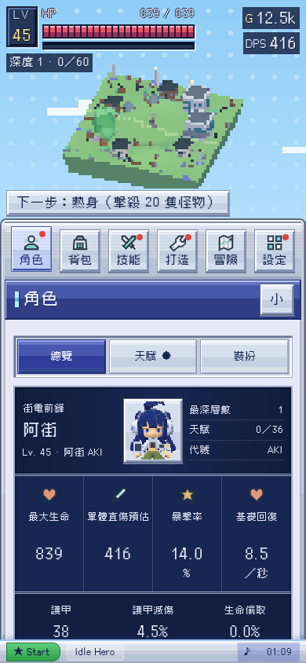
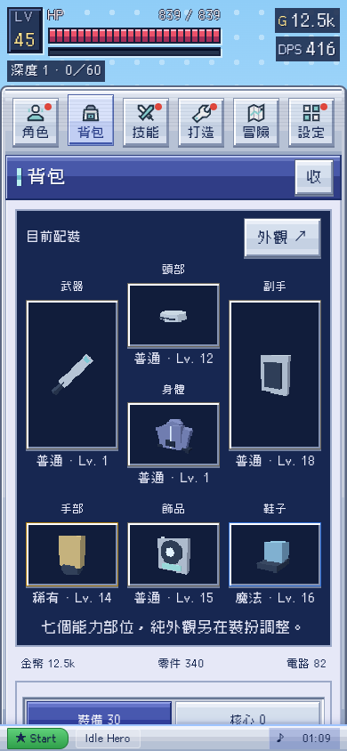
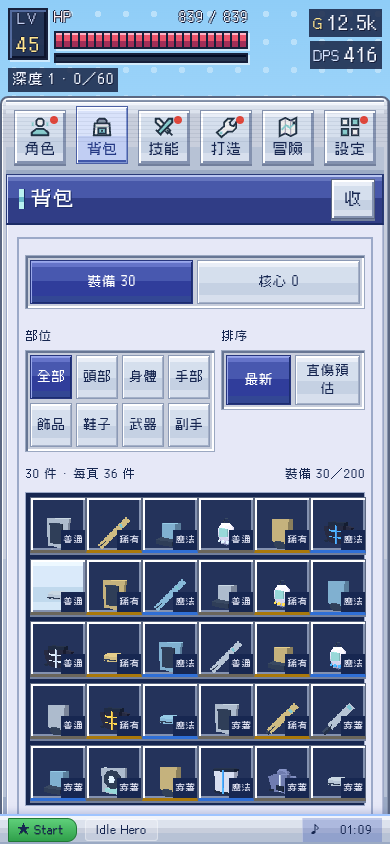
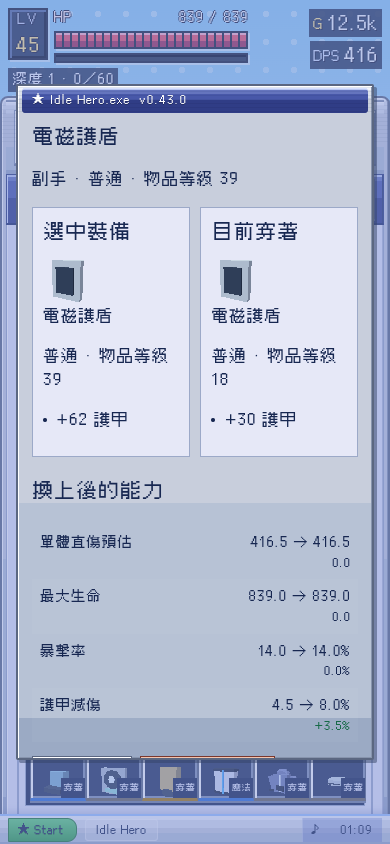
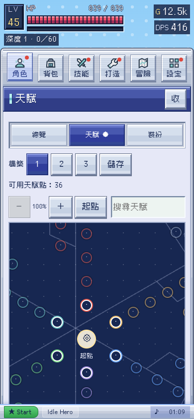
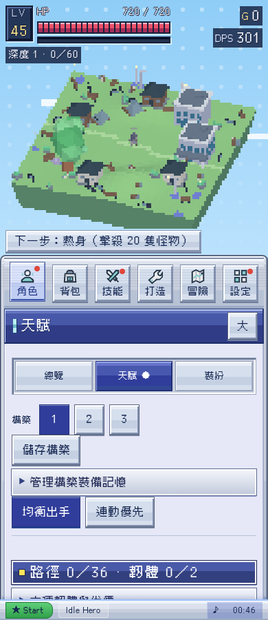

# 三頁優化與七部位裝備候選

日期：2026-10-24，香港時間。候選 v0.43.0；來源以 main 122a4c4 為基準，尚未合併／上線。[完整計劃](plan.md)。

本輪參考 Alan 提供的三張 參考截圖：採用其資訊順序、角色數值與配裝構圖，外觀仍是本作藍紫窗口、Y2K 低解析度裝置與像素字。沒有使用參考遊戲的 UI 圖像素材，也沒有捏造尚未實作的魔力、精神或抗性系統。

## 步驟與畫面

| 步驟 | 任務 | 現況 |
| --- | --- | --- |
| 1．角色 | 開角色頁，查看重要讀數，再讀生命／防禦／攻擊／元素／技能 | 已實作，真實數值與名稱逃逸驗證通過 |
| 2．配裝 | 在背包七部位圖查看穿著，再點網格物品比較及換裝 | 已實作，七類裝備、取消、保護回收、角色限制與五尺寸驗證通過 |
| 3．天賦 | 直接看盤面，選節點看效果，再分配／退回 | 已實作，已移除前置管理與策略區，選取不花點數，分配／退點與鎖定驗證通過 |

### 1．角色

重要資訊先於可展開的角色展示。四個主要讀數、三項防禦摘要及分類詳表沿用 G.st；元素列標示傷害加成，不冒稱抗性。長名稱不會改成 HTML，角色／外觀／裝備資料 owner 保留。

### 2．七部位配裝與背包

能力裝備為頭部、身體、手部、飾品、鞋子、武器、副手。外觀仍是武器、副手、飾品。欄位先看圖像、部位及稀有度；完整名稱、詞綴與數值透過點選取得，不把所有文字塞進每個格。手機六欄，320px 五欄，寬容器九欄；舊全域四欄樣式已被明確的背包變體取代。

比較視窗並排候選與目前穿著，320px 改直排；數字差異有正負號，不只靠顏色。回收仍需確認。候選與舊存檔都使用同一收藏、倉庫及構築引用，新增 equipmentVersion 遷移不重抽詞條。

### 3．精簡天賦

移除 Alan 劃掉的出手策略、完整預算卡、六韌體長說明與退點清單。可用點數與必要工具置頂；主盤不再被前置資訊推到下面。節點選取才出效果、代價及實際計算的預估；點選本身不花點數。清單與非拖曳控制收在末尾，方向鍵能研究節點。

### 現況依據

本輪改版前截圖確認天賦盤被構築與多層規則推到首屏之外。角色與背包的 before-* 截圖亦保留；final-* 為新候選使用示範進度的真實瀏覽器擷取，不是概念圖。早期試稿截圖已移除，避免與最終畫面混用。

## 驗證與限制

- 21 組來源檢查通過，含七類裝備四種稀有度、拾取、能力、存檔、構築及舊三欄引用遷移。
- 11 組實際瀏覽器流程通過，包含 320、390、768、844 橫向及 1440px；網格至少約 44px、無橫向溢出、換頁回頂部、查看不消耗、退點、搜尋清除、減少動態、七部位同時保存及角色展示。
- 最終字體、語法、DESIGN lint 及單檔驗證見本目錄；單檔所有非文件網路請求被拒絕後，真實角色預覽仍可顯示，沒有頁面錯誤。
- 靜態 audit 仍回報既有 05k-phone.js 的兩個事件委派按鈕 actionless 提示，未宣稱整份靜態審核全綠。本輪沒有新增相同問題，也未改手機 owner。
- Chromium 軟體 WebGL 不等於 iPhone Safari 真機或長時間 FPS。七部位一般裝備採基本低面數簡模；佩戴美術及新增配裝的進度平衡另列待辦。
- 七部位存檔可由舊版升級，不保證回匯至舊三欄版本能保留新物品；試玩候選前先匯出正式進度備份。
- Claude PR #34 的隱藏戰場／效能工作尚未納入本候選，整合時需保留；本次未改其 uiTitle 偏好判定。

最後補充：舊專裝移位後，核心重構仍按原本的固定詞綴種類成長。舊手機的 +2% 暴擊不會誤套新副手護甲的成長倍率；已補回歸驗證。

發佈狀態更新：Alan 後續要求 release，本候選已於 PR #35 整合 Claude PR #34 後發佈為 v0.43.0。以上候選驗證與限制保留歷史狀態，新的整合及線上核對見 ../release-0.43.0/。
