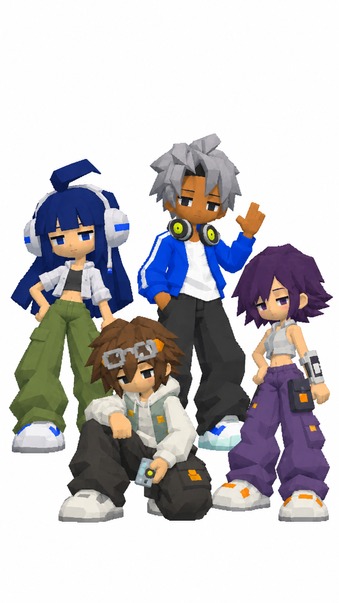

# 現行角色設定總表

2026-10-28 · Asia/Taipei。核對基準：main `641c43d`。這是現行程式與已批准造型的閱讀整理，不新增人物設定；本文件與索引尚在 `codex/character-turnaround-preview` 任務分支。完整來源見[檔案索引](character-settings-index.md)，疑點見[一致性審查](character-settings-review.md)。

## 使用方式與設定層級

- **遊戲職業名稱**：戰士、樂師、獵手、寵機師。創立後職業固定，玩家另取自己的名字，各存檔進度獨立。
- **模型／美術代號**：AKI、MILO、PING、NULL，用來辨認四款造型；不強制玩家必須使用這些名字。
- **歷史稱呼**：阿街／米洛／小訊／阿零見舊交接；茜／蓮／結衣／太一見[早期草案](characters.md)。兩者不能直接當成現行已定稿本名或混接成同一套人物小傳。
- **現行故事**：採電台訊號失常的夏日街區。日常背景從 `street-world.js` 取得，職業、能力從 `characters-data.js` 取得，昇華從 `02b-careers.js` 取得。`index.html` 載入順序決定最後顯示內容。
- **設定空缺**：現行來源沒有完整確認的年齡、性別認同、生日、人物關係、個人長篇任務或正式背面服裝設計。不可將草案的22／24／21／26歲等資料自動移植。

## AKI｜戰士

- 儲存鍵／模型：`street`／`aki`。
- 身份：街區電力維護。定位：近戰、連鎖電擊、護盾續戰。
- 現行背景：每天巡街修電，也替小店接好試音的延長線。今天第一次遇上會自己逃走的拖板。
- 外形辨識：藍黑長髮與齊瀏海、白藍大型耳機、灰白短外套與深色短背心、軍綠寬工作褲、白藍厚鞋。以原圖和實際模型為準。
- 基礎能力：增加傷害10%；「短路連打」基礎7秒一次，先重擊近處目標，再跳電至最多3個鄰近目標。普攻命中累積短暫護盾，基礎上限生命5%。
- 三條昇華：**接地鐵衛**（防護與續戰）、**電弧破陣**（增加跳電目標）、**超載鬥士**（提高攻速、縮短專技間隔，犧牲回復）。
- 相關裝置：修補耳機、伸縮電棍、腰鏈、插頭吊飾。這是專裝設計清單，不代表初始全部持有或同時穿戴。

## MILO｜樂師

- 儲存鍵／模型：`frost`／`milo`。`frost` 是保留的歷史鍵，不能據此把職業解讀為冰系法師。
- 身份：聲場調律。定位：中距離、環形音波、連擊加速。
- 現行背景：唱片店換帶時間的常客，能從走調的廣播裡聽出重複節拍。這次想讓整條街各自的聲音回來。
- 外形辨識：暖棕膚色、銀灰短髮、鈷藍寬外套、白色內搭、深灰寬褲、頸掛耳機及厚運動鞋。
- 基礎能力：攻速增加8%；「低頻環流」基礎7秒一次，對周圍半徑42的敵人施放音波。持續普攻可累積5層節拍，加快專技計時，基礎最多20%；中斷3秒重置。42是遊戲世界距離單位，並非公尺。
- 三條昇華：**回聲奏者**（延遲回放音波，降低本體傷害）、**靜域調音師**（短控場與技能急速）、**疾拍行者**（增加節拍上限與攻速，犧牲生命）。
- 相關裝置：DJ耳機、MD隨身聽、成對音盤、條紋腰帶布帶、MD肩帶。

## PING｜獵手

- 儲存鍵／模型：`beep`／`ping`。
- 身份：訊號追蹤。現行定位文案：遠程投射、標記追蹤、會心。
- 現行背景：熟記店家、班車與送貨路線，靠摺機和通訊器追查錯送的訊息。出發前總會先回覆鄰居。
- 外形辨識：紫黑外翹短髮、冰灰短身無袖上衣、紫色寬工作褲、白橙厚鞋、側腰包與不對稱前臂裝置。
- 基礎能力：會心率增加6個百分點、攻速增加6%；「訊號連射」基礎6秒一次，按距離選取最多6個敵人，各發出2.8倍傷害的訊號彈，依會心率判定。普攻討伐敵人後，下一輪職業連射增加25%傷害。
- **描述限制**：目前職業專技沒有獨立「先標記再追蹤被標記者」的流程；「標記追蹤」是現行文案，不能據此承諾額外標記操作，詳見審查。
- 三條昇華：**定頻狙手**（少目標高倍率與會心）、**分流追獵者**（更多目標、降低單發倍率）、**殘影速行者**（閃避與攻速，犧牲生命）。
- 相關裝置：通訊耳機、郵差包、前臂發射器、翻蓋手機、髮夾、郵差包肩帶。

## NULL｜寵機師

- 儲存鍵／模型：`volt`／`null`。`volt` 是歷史鍵，不代表只能使用雷電技能。
- 身份：電子寵機改裝。定位：召喚、持續輸出、修復增益。
- 現行背景：把舊寵機修成可靠的小幫手，常替修理攤試零件。希望每一台被修好的設備都有地方回去。
- 外形辨識：茶棕短髮、額上方框護目鏡、奶白帽衣、薄荷灰背心、炭灰寬褲與厚鞋；控制器為重要手持辨識物。
- 基礎能力：增加傷害8%；寵機自動索敵攻擊，「寵機出動」基礎8秒一次，增幅4秒，期間寵機傷害增加50%。每8次有效攻擊可修復生命1.5%，仍受共用回復額度限制。
- 三條昇華：**雙核馭機師**（更快攻擊並追加次目標）、**維修監督**（強化修復，降低寵機攻擊傷害）、**熔核改裝師**（較慢直擊與濺射）。
- 相關裝置：防護眼鏡、電子寵物控制器、電池盒、浮游寵機、頸繩。**NULL的職業寵機與全隊故事收音機同伴是不同設定**，不可混作同一角色或共用取得條件。

上述均為無昇華／無昇華天賦的基礎說明；實際數值受昇華與天賦影響。四職業仍可自由使用已取得且手動接通的共用技能，不以電子裝置題材限制元素或武器。

## 故事配角與同伴

| 人物／稱呼 | 現行身份與故事作用 | 已有資料的限制 |
| --- | --- | --- |
| 小禾 | 修理工；修風扇、查異常電纜、改轉播排程 | 不等同AKI；未確認年齡、外形與私人關係 |
| 阿澄 | 渡船員；守港口、接海岸訊息、協助跨站聯絡 | 不等同MILO；未確認完整造型 |
| 阿夏 | 唱片店人物；交付前街委託、協助換帶與比對播放表 | 未確認是店主或店員，不從稱呼自行補定 |
| 阿嶺 | 巡線員；山路、營地、風車供電查核 | 未確認完整造型／人物小傳 |
| 夜市老闆娘 | 找回收音機，恢復點餐廣播 | 沒有已確認本名 |
| 河邊站務員 | 找回麥克風，對照報站與轉播排程 | 沒有已確認本名 |
| 高地值班員 | 雪線轉播亭值班、回覆下山提示 | 沒有已確認本名 |
| 港口值班員 | 更正貨運與收音機配送順序 | 未證實與阿澄為同一人物，保持分開 |
| 鄰居廣播／街角電台的大家 | 群體呼聲與委託來源 | 不是已確認的單一NPC姓名 |
| 收音機同伴 | 黃色切面收音機殼、偏置天線、調諧槽與旋鈕；跟隨、失物慶祝、章末標記 | 不使用卡通笑臉，不計入十二款敵人，亦不等同NULL職業寵機 |

故事來源：[story.md](story.md)、`street-world.js`、`street-neighborhoods.js`。收音機同伴造型以 [monster-catalog.md](monster-catalog.md) 為準。十二款敵人和首領沿用該檔案的唯一名單，不另建一套角色目錄。

## 美術與三視圖使用規則

保留已批准四人剪影、衣服與四肢比例，套用使用者當前指定的semi-lowpoly、flat／unlit matte、有限色塊及低解析像素五官。人物允許簡化五官；怪物／共用同伴的無卡通笑臉要求不可誤套成「人物全部無五官」。素材白底不等於遊戲背景白底。

三視圖需正面／側面／背面同尺度、中性站姿、完整留白；目前四人合照只充分呈現正面造型，側背細節屬待核對設計。單人圖可以不展示裝置，但不能據此取消職業寵機或把未穿戴專裝當預設擁有物。AKI首張候選不是新的人物定稿。
