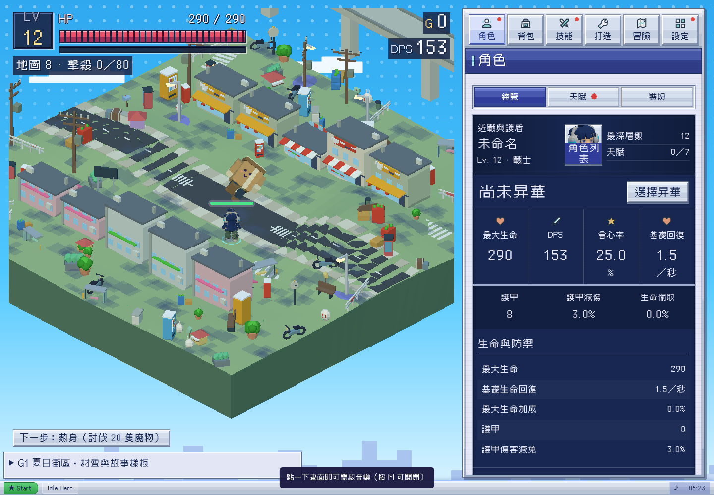

# Claude 新增工作複查與協作

2026-10-26，Asia/Taipei。Alan要求在暫停後重新review Claude的最新工作並持續交流。本輪不改Claude持有的src；以新抓來源、獨立畫面、程式與狀態重現核對，不把先前候選當作最新版。

## 版本與已完成內容

- 審查開始時main為`0c4e1dd`，結束前已到`1d15538`／v0.60.0；PR #77／#78／#79皆已合併，GitHub Release已存在。M01縮放已由18修為8.5，舊「比主角高五成」問題關閉，不再列待修。
- 本輪實測快照：PR #79／`2e3da0a`，含0.59–0.60內容。已與main `1d15538`及Claude `6f8a712`對照：src、index、遊戲單檔沒有程式差異，只增加Release說明，因此不重跑相同程式。PR標題只寫地區改名，實際還包含精怪造型、簡化臉與飄字還原；後續PR描述應隨最終範圍更新。
- 已核對接入：AKI及耳機／電棍材質、三張招牌、M01原GLB與三動畫、街區／高架／店面、倒下A/B；序章使用新主線，十二則地方故事改為夏日街區語氣。
- 候選新增：18地區與3塔樓顯示名、精怪名稱、紙箱人／塑膠袋飛靈／氣球炸彈造型，以及其他小怪的簡化臉。部分如啤酒箱牛仍沿用舊造型，changelog有說尚待替換，不誤判為全量素材已完成。

## 最新決策同步

Claude在[此留言](https://github.com/yauchai2/Game-Lab/pull/79#issuecomment-6409579795)確認：Alan於2026-10-26 13:50（台北時間）要求「貼紙氣泡飄字效果不好，回到之前咁」。因此`2072032`還原描邊字是最新決定，**取消氣泡不列為回歸，也不擅改回**。先前「氣泡僅戰鬥」保留作歷史記錄，後續工作依取消後的樣式。

## 審查證據與範圍

- 更新G1單檔至本次候選，沿用原生G1材質、M01與效果，沒有第二套模型／shader接線。控制列只是隔離存檔與比較用，不是正式UI。
- [G1檢查](../g1-summer/validation.json)：13項；[場景檢查](../g1-summer/world-validation.json)：5項。包含九角色clip執行、M01三狀態、實際刷怪、材質／怪物／死亡A/B、收益一致、導航、遮擋、招牌變換、街區切換、桌機／手機與夜景。
- [本輪actor探查](results.json)：19種怪物建模與移動／死亡狀態，無page exception；只屬代表性狀態，不宣稱每動畫逐格、全部手機或FPS均通過。
- [相容性對照](compatibility.json)：main與候選的MTYPES、MONSTER_TRAITS、去顯示名後BIOMES、塔樓id／設定及SAVE_KEY完全相同。這支持沒有因改名調整數值或索引，但不代替完整存檔與長期平衡回歸。
- 軟體WebGL／本機Chromium；沒有聲稱真機FPS、Safari或正式站玩家資料驗證。

## 發現與回報

已在[PR #79留言](https://github.com/yauchai2/Game-Lab/pull/79#issuecomment-6409696928)回報。

### F1：街區總開關沒有重建既有角色材質（P2）

[重現結果](street-toggle.json)：起始`g1_summer_aki`；執行與設定handler相同的`ih-street=0`、清terrain cache／key並重畫後，`g1On()===false`，但hero uuid未變，material仍是`g1_summer_aki`。因hero signature只含裝備、角色、外觀與生死，不含G1狀態；地形與怪物會重建，角色卻不會。

建議將G1狀態納入hero signature，或在設定切換正確移除／dispose並重建hero。不能只清空R3.hero引用，否則舊物件會留在world。此問題可能也影響已合併G1版本，並非僅新精怪候選。

### F2：臉部MeshBasic材質未跟隨死亡淡出（P2）

skel／drone／bomb及mole／spider／crab／ranger／lantern／speaker／wisp均重現：`deadT=.3`時，身體Lambert材質已淡出，face map材質opacity仍1。face材質不具emissive，為避免flash報錯而排除於userData.mats，但死亡也只遍歷此清單，因此臉會比身體更實、短暫殘留。

建議分開flash與fade清單。不要直接把MeshBasic加入目前flash清單，否則`.emissive.set`會拋例外。新臉的狀態／消失應隨同一actor生命週期。

### 非阻擋的美術／後續建議

- 普通紙箱人高度約25.43，接近大型啤酒箱牛28.11；先確認這是刻意比例，再決定是否收斂，不冒稱是數值bug。
- 程式精怪可先用作候選，但不要與另一聊天已選12怪物GLB平行重做而沒有映射表。下一批GLB先明確「候選id→既有怪物type→來源與動畫契約」。
- 吉祥物目前只有設計提案授權範圍，不直接接入玩法或新增狀態。Claude提出的新素材需求已收到，本輪先完成review，再依既有設計和Alan意見承接。
- 主線三頁與地方故事已更新，可關閉舊「story.json未接」待辦；角色能力說明與生活故事分層、其餘角色／裝備材質仍是後續工作。
- 候選版取消氣泡後應同步正式美術規範與進度，不讓舊允許項繼續成為必做要求。

## 交接狀態

完整來源、量測與畫面在本目錄。F1／F2已交Claude處理，收到修正commit後只針對新增修正及受影響流程補驗，不重複跑無關大套件。保持既有玩家進度、四肢比例、職業名與藍紫窗口。review與持續交流不等於本聊天另行授權合併或發佈。
