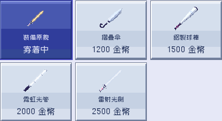
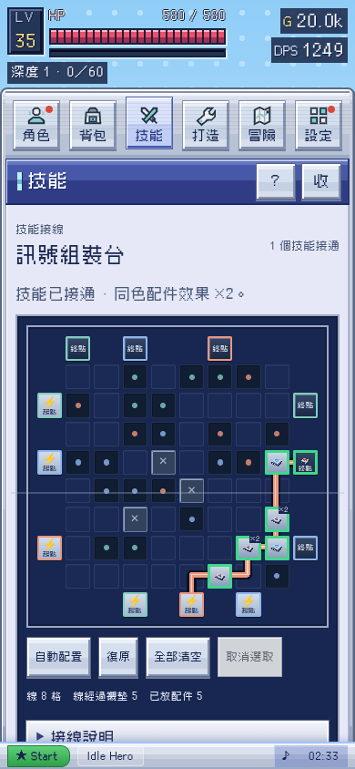
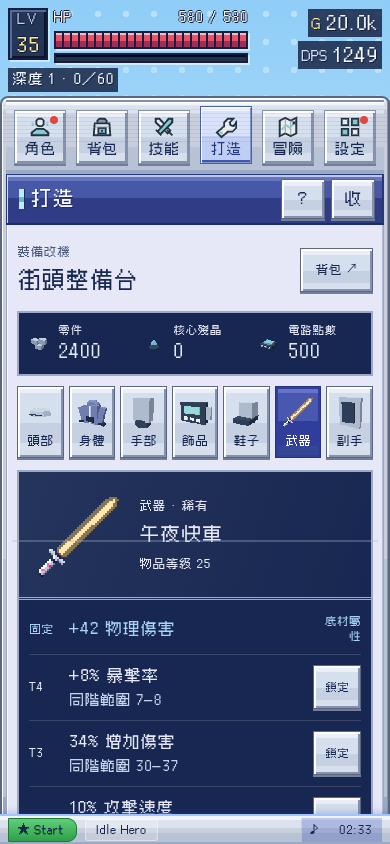
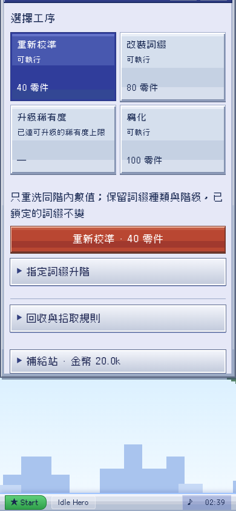
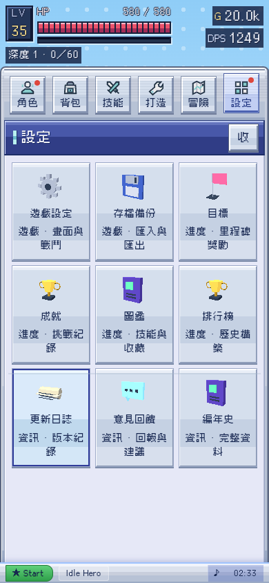
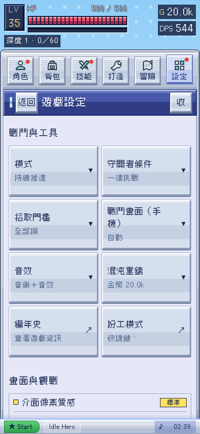

# v0.44.0 裝置介面與 3D 物件候選

日期：2026-10-24，香港時間。基於 main 8fb03af／公開 v0.43.0。這是可審閱候選，尚未合併或上線。[完整計劃](plan.md)。

Alan 提供的四張截圖是主要現況依據；另保存本輪 before-* 實際瀏覽器擷取。打造參考同類遊戲 的物品／詞綴／材料決策順序，內部設計討論才記錄 參考遊戲；不宣稱另行登入研究其打造介面，也沒有搬用對方圖像或機率。

## 1．裝備、裝扮及物件：已實作並驗證

裝備原貌依目前穿著物件產生 3D 縮圖，不再固定顯示平面劍／盾圖示。四種普通武器與武器裝扮共用原有 WEAPON_MODEL，恢復摺傘、球棒、光管、光劍的不同幾何；角色手上的普通武器亦使用同一 builder。純外觀與專裝模型的原有優先序保留。

技能、配件、遺物及成就獎章也有快取 3D 呈現。原本的十六件上傳 GLB 與來源雜湊不變；四件缺原檔項目使用明確標記的程序式 3D 代用品。沒有冒稱取得新原檔，也沒有改裝備 ID、機率或能力。

圖像使用既有單一 ICON3D renderer 畫成 PNG 後快取；實際場景仍是 3D。沒有為每張圖加入持續動畫 canvas。WebGL 失敗保留文字、操作與降級圖示。

## 2．技能盤：已實作並驗證

改為與角色配裝面一致的深藍裝置內艙：較安靜的格槽、金屬端口、三色路徑與 3D 機件。移除大成功框、危險斜紋、常駐閃爍及互相堆疊的舊配色。提示縮短，圖例收進「接線說明」。

保留 10×10 盤面、分級開放、同色加成、點選技能與配件、拖線、清空及復原。新樣式的實際指標拖線已驗證能連接起點與終點，不只檢查邏輯函式。

## 3．打造：已實作並驗證

七部位選擇列收小，選中的裝備、稀有度、物品等級與詞綴成為主體。四項工序用兩欄鍵座，分清可否執行、成本與真正扣款的按鈕；隨機改裝不顯示虛構的下一次結果。

鎖詞綴、同階校準、指定升階、核心重構、腐化的規則與交易 owner 不變。校準後顯示實際結果；腐化仍先確認，不足材料、已腐化或不支援的操作都有原因。切換目標／工序及取消不扣費。

## 4．設定：已實作並驗證

九個入口排成連續三欄，不再各分類留下大塊空位；320px 採兩欄。設定項目本身也使用格網與一致鍵座，保留原 DOM、事件、目前值及偏好儲存。重新進入設定回到頂部，修改同頁保持位置。

手機技能、打造、設定與資料工具預設收起戰場，讓工作內容先出現；玩家明確設定的戰場大小優先。角色與裝扮仍沿用原展示流程。

## 驗證及限制

- 21 組來源檢查通過，包含裝備／存檔／構築、原有玩法、離線與字體。
- 11 組實際瀏覽器流程通過，涵蓋全部公開裝扮、四種武器幾何、二十款專裝、技能／配件／遺物／獎章縮圖、點選接線、配置／復原、鎖詞綴、扣款、腐化取消／過期目標／單次執行、設定保存及五個 viewport。
- 額外實際指標拖線通過；新版盤面座標仍可正常連線。
- 離線單檔拒絕所有非文件網路請求後，真實角色預覽仍能建立；零頁面錯誤。字體、語法及 DESIGN lint 另存本目錄。
- strict 靜態審核仍有既有 05k-phone.js 兩個事件委派按鈕的 actionless 提示，未宣稱整份靜態審核完全通過。
- 不宣稱 Safari 真機、長時間 FPS、完整報讀器或四件缺檔代用品的最終佩戴美術已驗收；縮圖快取不能等同實測效能改善。

各結果見 source-checks.json、browser-results.json、drag-results.json、bundle-results.json、static-audit.json。早期 after-* 試稿已移除，final-* 才是本候選畫面。
