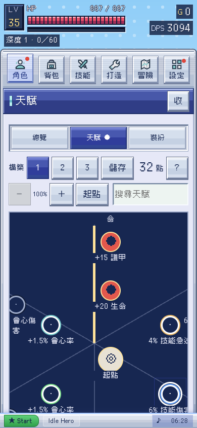
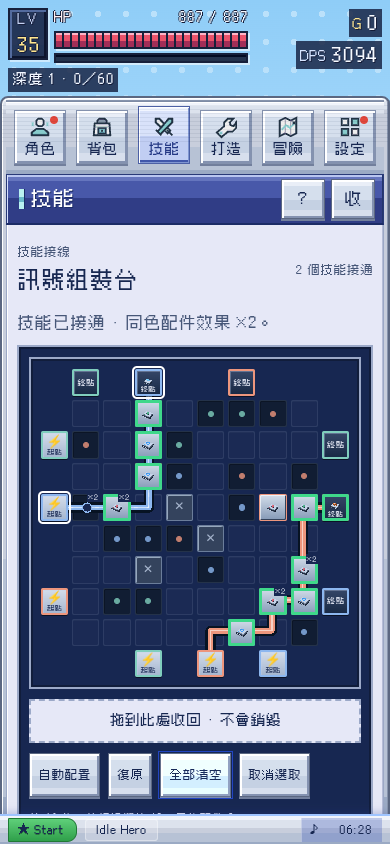
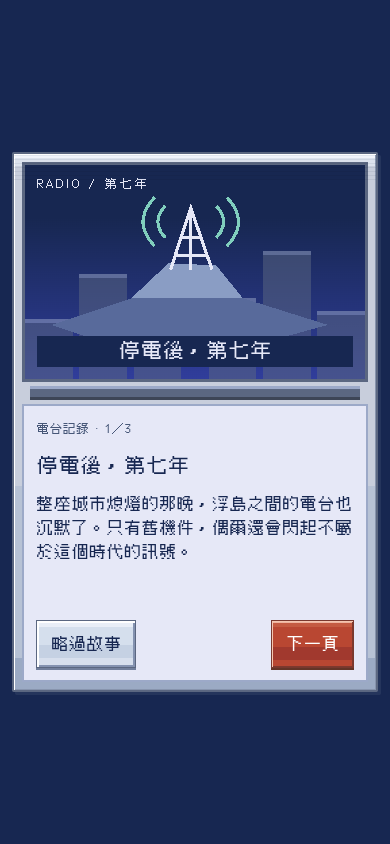
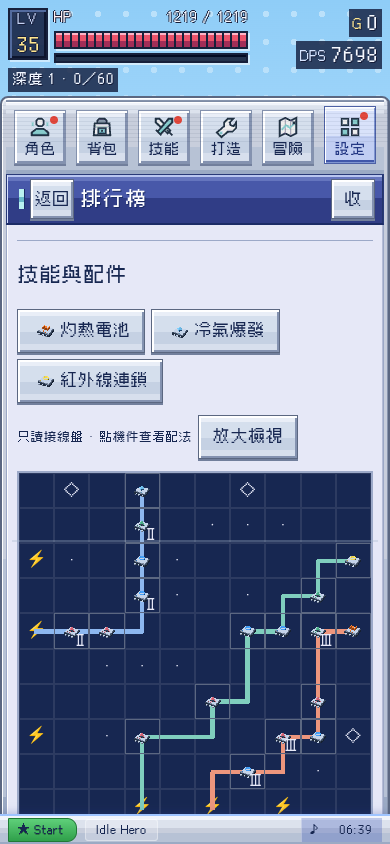

# v0.45.0 候選：直接操作與新手體驗

已實作及驗證，尚未合併或上線；正式網站維持 v0.44.0。本輪基於 main eb204c4，Claude e0b3468 的角色命名及台詞已在基底內。

## 天賦：一下加點，效果看得清

合法節點點一下即分配 1 點，不需再按確認。點已分配或未連接節點只看詳情，不會重複扣點。64px 點擊範圍、36／46px 節點及 14px 效果標籤，間距較原版加倍；盤面可平移、縮放及搜尋。鍵盤方向鍵只研究，Enter／空格才執行；末端退點、有限預算與挑戰限制保留。

## 技能盤：機件可以搬，不只可以拉線

盤上的技能可拖到其他已開放終點，配件可拖到其他色塊位；同類可交換。拖到收回區會回庫存，不銷毀物品。區外、無效格、取消、離頁、失焦及來源改動都不提交。成功操作可復原，技能位置改變時保留原插槽接線，需按同色規則接通。

不想拖拉可點機件 → 移動 → 點目標；原有配件選單及庫存拖入仍保留。修正原生圖片拖曳打斷指標事件，觸控機件與電源作手勢把手，空白區仍可捲動。

## 新冒險：短故事 → 起始角色 → 遊戲

序章是上屏電台場景、下屏對話，三頁短文可以略過；接著選茜、蓮、結衣或太一，選好才開始戰鬥及保存。選中的角色立即可用，其餘沿用冒險解鎖。開始前重新整理會接續故事／選角；已有有效存檔直接續玩，不改自訂暱稱或角色。

頭像沿用既有 3D 模型快取，載入時保留位置並自動補圖；失敗仍可讀姓名選角。瀏覽器不能保存時明示失敗並提供匯出備份入口。沒有強制等待、外部素材或新世界觀。

## 頁面減法與微互動

- 角色：撤下與背包重複的七裝備及收藏展開，改為配裝、裝扮、故事、事件四個短入口；數值表與個人資料保留。
- 背包：保護規則收進問號，容量讀取 whCap，不再把可擴充倉庫寫死為 200。
- 冒險：全景與手記確有用途，改短工具列；手記收錄數依真正收錄旗標計算。
- 技能：構築配置與戰鬥分析按需打開，保留真實出手戰報，沒有直接刪掉有用功能。
- 全工作頁：共用 hover 亮邊、焦點與內凹按壓，沒有版面位移；減少動態停用過渡。訊號三色由 UX_THEME 統一供技能盤及只讀盤使用。

## 拾取：物品本體慢慢吸入

拾取距離維持 12。範圍內開始約 0.85–1.65 秒的吸附，物件本體向角色靠攏，到達才入袋；不是先消失再補光點。死亡時暫停，中途存讀保留吸附狀態，離線直接結算已開始吸附者。到達後只派發一次，不改掉落機率或回收規則。

## 構築觀摩：完整配法，只讀查看

修復舊快照只留下三件裝備的問題，新構築碼保存七部位、全部詞綴、天賦節點、出手策略、技能卡匣及輔助配件階級。只讀盤預設顯示全盤，可放大至 480px 橫向探索；點技能看模式與配件、點配件看階級及同色倍率。使用同一 GridLab.resolve 計算，不臨時換掉自己的盤面。

舊碼缺少的部位、節點、模式及階級均明示缺漏；不補成假配置。返回鍵回榜單，不繞回設定目錄。手機預設收戰場，明確設定仍優先。

目前仍是本機紀錄及朋友分享碼，沒有全球即時排行榜服務；「示範」不冒稱真人。新格式向舊 IHB1 碼相容讀取，舊碼本來沒存的資料需要對方重新分享。

## 驗證與限制

- 21 組來源回歸通過；角色鍵及保存細節補跑既有角色／七部位／UX 與新狀態檢查。
- 10 組新瀏覽器流程通過，包括五尺寸、鍵盤、減少動態、原生 Chromium 觸控輸入、移位取消及構築碼防壞資料。
- 11 組既有角色／背包／天賦工作區流程通過，測試同步更新為直接加點及裝扮頁共用展示。
- 追加檢查：過期拖動拒絕、全部角色頭像與降級、保存失敗備份、手記數目、離線核心入口、排行榜身份／全盤／放大／返回。
- 單檔在所有外部請求被拒絕下，角色預覽及七部位仍可用，無頁面錯誤。字體、建置一致性及變更來源語法通過。
- DESIGN lint 無錯誤／警告。靜態審核仍只有 05k-phone.js 兩項既有事件委派按鈕提示，未改手機 owner，不把整個 strict 審核報成全綠。

證據：source-checks.json、browser-results.json、workspace-regression/browser-results.json、polish-browser.json、state-checks.txt、bundle-results.json、build-check.txt、syntax-checks.json、static-audit.json、design-lint.json、artifact.json。真機 Safari／Android、長時間 FPS、完整報讀器及真人新手節奏仍待驗收。
