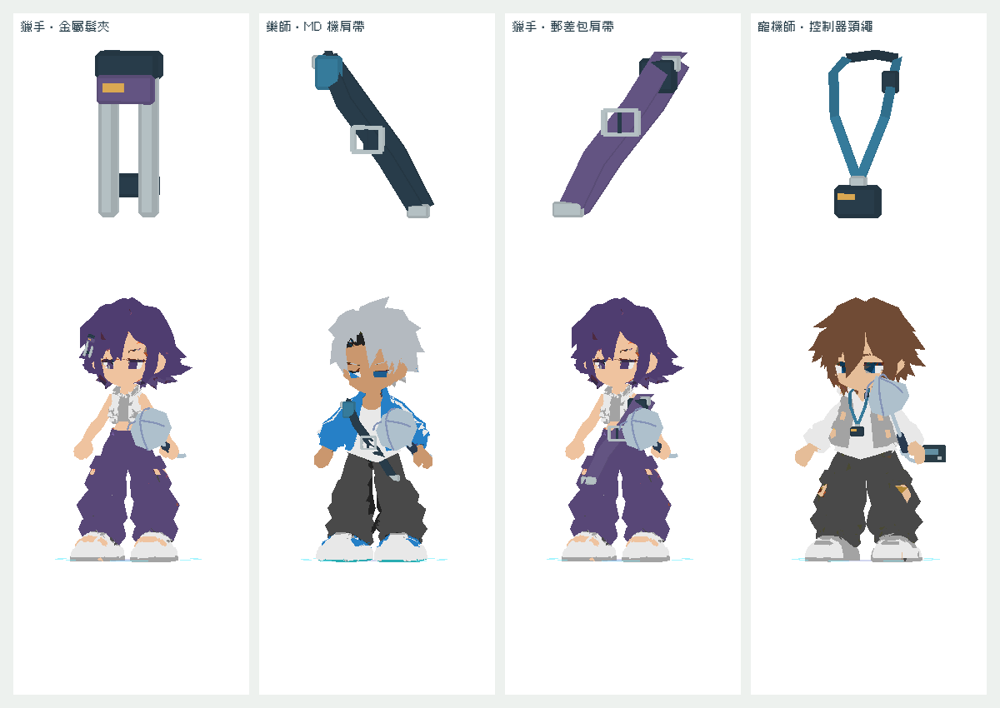

# 四件專屬裝備補完（候選）

2026-10-26，Asia/Hong_Kong。Alan要求繼續全遊戲精修，本批以main a428ceb／已發佈v0.64.0為基準，獨立分支codex/street-equipment-finish。**已實作／驗證，尚未合併或發佈。** 保留Claude最新b28dc60頭像列表修正，不在本批覆寫或混入；已在PR83同步分工。

| 裝備 | 新幾何 | 三角面 |
| --- | --- | --- |
| PING金屬髮夾 | 雙金屬軌、鉸鏈、紫色扣片及琥珀色嵌塊 | 232 |
| MILO MD肩帶 | 環身扁帶、肩墊、可見鏤空帶扣、MD固定扣 | 260 |
| PING郵差包肩帶 | 加寬反向斜帶、厚肩墊、調節扣與連接端 | 260 |
| NULL控制器頸繩 | 分叉繩帶、後頸段、安全扣、控制器固定座 | 220 |

這四件是本專案新製的原創Blender幾何，取代以前的Box／Torus runtime代用品；不是後來收到了使用者原始模型。原有十六件模型未覆寫。共972三角面、四份GLB共40,264bytes；每件有Blend、保留的native export、正規化unlit GLB、manifest、遊戲原生縮圖，catalog含SHA-256。

## 美術規格與來源

承接Ice Cream.mp4中的青年配件、肩帶、金屬扣與厚實街頭用品語言；不複製影片中的商標／圖案。共用規格：semi-lowpoly、Y2K PS1/Dreamcast氣質、chunky、寬切面、flat／unlit matte、無圖像貼圖／UV細節。以深藍灰、銀色、低彩紫與少量琥珀色構成。禁用：寫實材質、磨損噪點、印刷字／標誌、細密織紋、可愛臉。

本機Blender製作，沒有ImageGen／Tripo／付費provider。未使用缺少的game-dev CLI，不聲稱其canonical package receipt。所有原始參考保留。

## 接入及驗證

- 沿equipmentModel共用reader／cache／socket，兩種風格模式都使用真正新GLB，不再回到舊圓環；Basic頂點色且零image maps。
- 髮夾移出頭髮遮擋，肩帶掛點下移、避開面部。現階段為隨相應骨骼移動的硬幾何配件，不冒稱布料模擬或全動畫逐像素無穿模認證。
- 收藏縮圖由同一模型原生渲染；ICON3D失敗時用對應新模型的預製PNG，不回舊代用品圖片。
- 移除四件pending／「原始模型待補」提示。原uid、owner、slot、aff、drop及存檔格式保留，沒有自動換裝。
- Blender stock importer重匯入四GLB；閉合拓樸、unlit與零貼圖檢查通過。原生reader的尺寸均max-span=1，對應職業可掛載，四件各九動畫的矩陣有限，共36clip檢查通過。
- 兩種風格×四件GLB＋強制GPU失敗的預製圖fallback通過；10既有gameplay測試通過；分檔網站使用新heavy資源實際啟動並重跑上述檢查通過。[記錄](runtime.json)。



## 重建

```sh
blender -b -t 4 --python tools/style/build_equipment_completion.py
python3 tools/style/pack_equipment_completion.py
python3 tools/build.py
python3 tools/style/build_preview.py
# 將本目錄以HTTP 8788提供後：
node tools/style/test_equipment_completion.cjs
# 原生render會產生icon.png；再pack即可更新GPU fallback。
python3 tools/style/pack_equipment_completion.py
```

預覽dist/street-style-preview.html只使用頁面記憶體存檔，不影響正式進度。此輪只完成四件缺件，其他一般裝備、敵人辨識、逐場景／劇情／聲音與真機驗收沿單一backlog繼續，不稱整個專案已完成。
