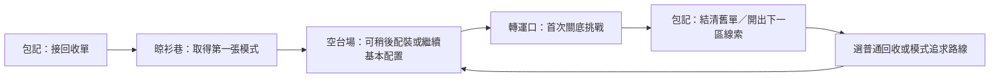

# 第一街區內容規格：橋底里

2026-10-28 · Asia/Hong_Kong。詳細文字設計已完成；所有新委託、路線權重、首通獎勵與回報格式均未實作／平衡。世界制度見[world-current](world-current.md)，劇情總線見[story](story.md)，構築及狀態規則見[game-design](game-design.md)。此處的Q／R標記僅供文件追蹤，不是新增的存檔鍵。

## 本區要讓玩家親身明白的事

帶著可用基本構築接一張回收單，發現新模式，試到攻擊形態變化，再選擇下一個想追求的東西。故事讓玩家理解物件為何流通；重玩由不同模式、詞綴與敵群組合成立，不要求每次重播「第一次找到卡匣」。

第一輪以約8–12分鐘自動推進內容作調校假設，玩家不需全程在線；這不是現用遠征系統已支援的長度。忙碌玩家可在任何已保存節點離開，回來保有已結算經驗與掉落。首區完成時間、掉率及難度均須之後用正式模擬驗，不把假設包裝成測試結果。

## 地區流程

箭頭代表內容順序，不是要新增可手操自由移動城市。路線與活動入口沿用現有冒險頁；工作枱、攤位與通道先由場景／短文本呈現，不新增四套商店系統。

## 一次完整冒險的節點

| 節點 | 玩家看到／做到 | 固定內容 | 隨機部分與離開規則 |
| --- | --- | --- | --- |
| Q01 取消得太遲 | Bo請玩家收走一箱舊件；Ren帶來取消單，但搬運機已開始收貨 | 一次接單短文、基本構築可出發，包記與庫存一直可用 | 不抽取是否能開始；對話可略過、可回看 |
| Q02 箱底有嘢 | 晾衫巷清開第一批設備後得到無型號卡匣；揭示它能改變輸出形態 | 新角色首張指定為分裂電池FIRE_SPLIT，使用現有1級FIRE與合法基礎供電配置 | 固定教學首件不消耗正式稀有掉落；重玩不再領首件。離線取得後列回報，不強迫立即裝 |
| Q03 試一試先 | 回到空台場可比較原始灼熱電池與分裂電池；願意的人才改配置 | 說清分裂增加鄰近目標覆蓋、沒有其他目標時收益受限；可沿用原本配置繼續 | 試驗無正式掉落、成就或劇情通關，不在試驗複製裝備；關閉即返回原構築 |
| Q04 你張單冇呢件 | 轉運口的回收設備攔截仍有收據的貨；玩家完成關底挑戰 | 固定目的、固定關底身份；關鍵前搖可辨，四角都能自動戰鬥完成 | 外圍敵群組合變動，首通劇情不能靠重新進出重抽；失敗保留已結算成果 |
| Q05 照單收返 | Ren交出收貨編號；Bo付原定報酬，卡匣由清單中的報廢樣件轉交玩家 | 一次委託報酬、下一區高架倉線線索、首區模式渠道開放 | 隨機戰利品另按掉落owner結算；重看對話不再發獎 |
| R01/R02 再出去 | 玩家追求普通回收或已解鎖模式家族，帶新配置再試 | 有穩定基本資源來源、能看到追求方向 | 新組合與詞綴是重玩理由；不重播取消單，不把整區首領當每日功課 |

首件FIRE_SPLIT是本輪新手流程決定，現行掉落／收藏仍有同模式來源。接入須以既有收藏／實體卡匣判定首件及重複物用途，不能領兩份首通獎勵；已有收藏的玩家保留原物，本區教學可直接略過，仍取得未領的普通委託報酬。所有四角都可用共享FIRE，不把它改成Jax或Vee專屬；四個職業技與被動仍各自保留。

首件提供一個確定可玩的新行為，之後才以七個模式的分批開放與隨機掉落建立驚喜。不是保證每次出發都有新模式，也不會同時把整個技能庫灌入新手背包。

## 可重複路線與追求方向

| 路線 | 敘事目的 | 掉落側重提案 | 代價／適合誰 |
| --- | --- | --- | --- |
| R01 空台回收 | 按已確認清單搬走舊件 | 普通裝備、零件、經驗；仍有模式驚喜 | 普通敵群與較平穩收益，適合離線／新配置觀察 |
| R02 倉邊散貨 | 找未整批運走的模式樣件 | 已開放的FIRE／CHAIN／BEAM模式家族相對權重較高 | 精英及混合敵群較多，失敗推進較慢；未定概率，不宣稱必得或收益全面較高 |

選擇一次路線後按原設定重複活動。未接入可調權重前，介面不能顯示虛假的「偏高掉率」；可先用現有可核對來源承載內容。首次轉運口關底是故事門檻；普通回收不要求每輪打同一首領。沒有遊戲內真實時鐘期限，玩家工作忙不會令店鋪倒閉或任務消失。

## 敵人與關底：借現有身份，補清遭遇用途

本輪已核對[十二模型清單](monster-catalog.md)、street-creatures與catalog。以下沿用現有模型名／type，不新增模型、不改舊type所擁有的AI、碰撞或獎勵。出現原因是回收流程仍在執行，並非所有設備都失控或有邪惡意識。

| 現有模型／type | 首區遭遇用途提案 | 對構築提出的問題 |
| --- | --- | --- |
| M01 插頭跳豆／slime | 晾衫巷低壓基礎敵群 | 原始攻擊是否能穩定處理？提供基礎完成感 |
| M02 拖板爬蟲／mole | 空台場分散目標 | 覆蓋與目標轉移是否有用？不只比較單次傷害 |
| M03 MD滑翔盤／drone | R02混合群中的游動壓力 | 覆蓋型配置與單線輸出的效率差異 |
| M04 低頻箱蟹／speaker | 轉運口首通關底，保留現行第1章模型映射 | 持續單體輸出、生存與空窗；不能靠無限連鎖小怪才打得動 |

關底文字演出：設備擋在貨道中央，先鎖定方向、再輸出一輪，回到停頓。這是後續演出／難度設計要求，不聲稱現行speaker已支援新招。首階段不加護盾免疫、強制破部位、精準閃避或只能某職業解除的門檻；沿用現有出手與預警owner，確認可讀性後才調招式。須有無小怪情境驗單體能力。

## 十二件首區及後續回訪物件：有限內容，能形成選擇

物件名稱是文案提案；來源欄標明功能是否現有。武器外觀不決定能否使用共享技能，實際相容以技能與配件資料為準。不虛構新詞綴數值，也不在此複製七部位規則。

| 物件 | 分工與用途 | 來源／狀態 |
| --- | --- | --- |
| 短柄衝擊工具 | Jax代表武器基底，近身衝擊外觀 | 角色文字已定；具體物品ID待接入映射 |
| 短棒導能器 | Vee代表武器基底，場域／導能媒介 | 同上，不新增萬能駭入能力 |
| 模組發射器 | Skye代表武器基底，投射外觀 | 同上，不鎖共享技能 |
| 短形維護工具 | Niko代表武器基底，機偶操作／防身 | 同上，工作機偶另依職業規格處理 |
| 鬆身工作外套 | 普通身體裝備，承托生命／護甲／回復等既有合法詞綴 | 文案提案；先從現有身體基底映射，不新增防護公式 |
| 分裂電池 | FIRE命中後向鄰近目標分裂，適合分散小群 | 現有FIRE_SPLIT；首件取得方式為新提案 |
| 引爆電池 | FIRE命中後覆蓋目標周圍，適合密集小群 | 現有FIRE_BLAST；首區後續隨機候選 |
| 分叉紅外線 | 多目標分叉，需附近有其他目標才有覆蓋收益 | 現有CHAIN_FORK；10級且滿足現有技能條件後介紹 |
| 過載紅外線 | 較強連鎖，換取更長冷卻 | 現有CHAIN_OVERLOAD，10級且滿足現有技能條件後列入候選渠道 |
| 掃射 | 三方向光束，單道強度下降 | 現有BEAM_SWEEP，16級且滿足現有技能條件後提供清場方向 |
| 聚焦 | 較窄單線、高單體輸出，失去廣域覆蓋 | 現有BEAM_FOCUS，16級且滿足現有技能條件後提供首領方向 |
| 撥號放電 | CHAIN原始命中供能，BEAM消耗電荷 | 現有BEAM_CAPACITOR，16級且已有合法CHAIN／BEAM後再介紹 |

七個模式現行行為可核對01-data；沿用原冷卻／倍率／上限，本輪不再抄數值。試用、模式池分段與首件贈送均未接入。固定模式解鎖不自動穿上，也不要求售出其他模式才能試。

## 先學一項改變，再研究三套組合

首區初次只比較FIRE基礎／FIRE_SPLIT，後續可發現FIRE_BLAST；兩種轉換的差異是分散目標與密集群體，沒有其他目標時不憑空增加覆蓋收益。CHAIN現行需10級、BEAM需16級，且可能另有圖紙／盤面條件；下列組合是後續回訪研究內容，不要求首區8–12分鐘內全部解鎖，不直接降低現有等級門檻。

### 三套後續研究目標

| 名稱（展示標籤） | 組合 | 玩家應看到甚麼 | 代價與限制 |
| --- | --- | --- | --- |
| 掃街 | CHAIN_FORK＋BEAM_SWEEP | 分叉與多束光處理分散群體 | 附近目標少時分叉價值低；不能把多束總和當每束傷害 |
| 點名 | CHAIN_OVERLOAD＋BEAM_FOCUS | 連鎖出手較慢，窄束對有效單線集中輸出 | 小怪覆蓋與頻率有代價，不能由模式名假稱必定最強 |
| 接力 | CHAIN基礎模式＋BEAM_CAPACITOR | 先有原始命中供能，後有光束消耗，前後循環可讀 | 冷啟動與供能空窗；回放／分叉不得無限自供能 |

這三套是所有角色可研究的共享構築案例；不是把四角變成同一技能。對同一場景記清場時間、首領時間、受擊／失敗、效果可讀性，找各自用途；不只選最高DPS。到達合法解鎖條件後，前兩套先比較，接力在玩家理解單一轉換後才露出。物品與接線必須合法持有且供電足夠，不能用文案跳過限制。

## 成就與解鎖

| 一次性目標 | 所需真實證據 | 獎勵提案 |
| --- | --- | --- |
| 自己改過 | 用合法配置完成一次正式普通路段，與初始配置有至少一個有效模式差異 | 研究記錄及相應模式渠道提示，不加永久全傷害 |
| 換個做法 | 同角色以兩種有效模式配置完成同階路段 | 開放相容的進階追求提示；接力候選仍須既有技能等級／圖紙／盤面條件，不直接填滿收藏 |
| 照單收返 | 首次完成轉運口並交代收貨編號 | 下一區故事入口與一次普通委託報酬 |

設計標籤不直接取代既有成就ID或獎勵。接入前逐條映射已有成就，避免再次發放同效果；離線只承認正式結算系統有記錄的行為，預覽／按套用不算完成。既有四角保持可用，新角色解鎖留待下一批角色有獨立玩法時設計。

## 首區對白與生活停頓

Bo：「雪櫃唔係廢件，仲凍㗎。」Ren看一下回收單：「上面話停產。」Bo打開冰箱拿出飲品，沒有再解釋。

同一個封路場景，每次只用當前角色的一句：Jax「人仲要行，塊牌你收返。」Vee「夜間禁用，收費冇停。」Skye「轉個彎囉。順路買埋嘢食。」Niko「門冇壞，佢等緊一個唔喺度嘅人批准。」其後由短事件帶路，不排四人輪流講價值觀。

勝利後Bo照單付錢，Ren坐在貨台綁滑板鞋帶，Mimo在一旁短跳回應。事件沒有聲望加一或全街鼓掌；下一個路線與新模式已可查看。所有對白可略過、日誌可重看；不因略過失去獎勵或必需資訊。

## 回訪與中斷處理

| 情況 | 必須保存／回報 | 不應發生 |
| --- | --- | --- |
| 打開回訪報告後立即關閉 | 已結算收益與新發現留在原owner，能重看摘要 | 關報告就失去卡匣，或再開再領一份 |
| 玩家未裝首張模式就離線 | 原基本配置繼續、卡匣在合法庫存／收藏保護內 | 自動換上新模式、停在教學彈窗或無故零收益 |
| 新劇情尚未閱讀 | 普通戰鬥／離線經驗繼續，故事節點待玩家查看 | 替玩家選交貨對象、冒稱離線已打通新章節 |
| 背包滿／物品被構築引用 | 沿用既有保護及回收規則；首通重要物有可核對保存結果 | 取消玩家收藏、覆寫鎖定物或無限複製暫存物 |
| 關底失敗 | 保留已結算成果、顯示卡住原因，可改配置或回普通路線 | 無限連死扣走全部成果，或要求手動閃避才可前進 |
| 存檔／匯入重載 | 首通報酬、教學首件、成就去重；已命名角色不改名 | 以新劇情覆蓋舊章節欄位，讓舊玩家重領／被重新上鎖 |

## 製作順序與驗收入口

唯一待辦在[backlog](backlog.md)，本節只是交付順序：先模式相容／取得對照，後首區事件與離線結算映射，再接美術及正式表演。恢復程式工作或樣板須依當前授權與協作分工；本輪只執行文字設計。

內容驗收先問：30秒可否說出新收穫、3–5分鐘能否試一項差異、同角色兩套組合是否各有用途、離線回來是否仍知道下一步。這些是之後測試目標，尚無真人或模擬結果。
