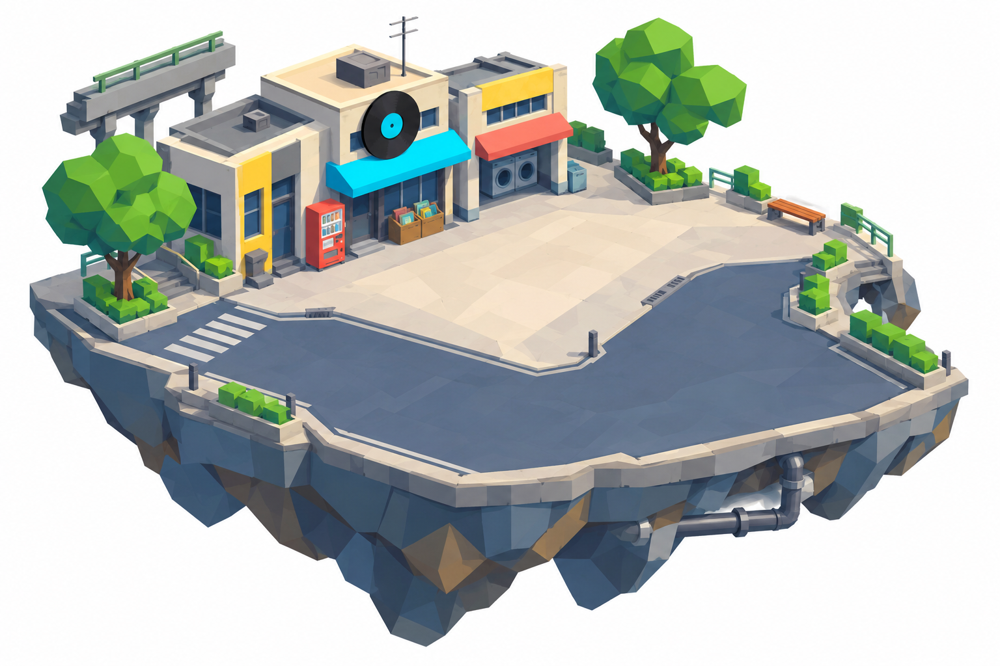

# 全地圖浮島重設：故事、尺寸與首張概念

> **最新進度：Alan已確認方向。** FI02已產出Blender／GLB、實際三視圖，並接入[原生可玩戰鬥候選](fi02/native-integration.md)。下列「等待方向」「未做模型」是首張概念階段紀錄，不能當現況；其他21場景尚未製模。

2026-10-27，Asia/Taipei。Alan新要求：所有地圖按更新風格重做浮島，重新評審大小、設計物件、逐張出圖，必要時三視圖，最後交遊戲用3D；先生成一張看效果。本批為提案與FI02首張概念，不替換正式遊戲，未製作新地圖GLB。

## 之前做過甚麼

main4c90e05／v0.72存在六章STORY_CHAPTERS、18普通地區＋3塔樓主題（共21個BIOMES），與獨立訓練平台。另有12個程序式地景profile／日常工作點：**profile不是21張逐張設計的地圖**，地形目前按terrainKey雜湊選profile。之前做的是色彩、生活點與敘事整合，未完成本次要求的全套手工浮島設計。

現行terrainBuild跨度按種子由144至648遊戲單位、另有長寬與自然外形變化；主要建築避開中心clearRadius。問題是島大小和故事地點不直接相連，可能形成大片空白，而不是每張有構圖的街區。新提案先取消隨機巨型作美術基準，讓每個地點擁有固定主輪廓、走路尺度及地標，再允許有界的小物變體。這仍是提案，未移除既有地圖大小／掉落系統。

## 一套名單

18張普通浮島、3張塔樓浮島、1張沿首張語彙衍生的訓練坪，共22個場景版型。沿六章既有失物與訊號追查，不重寫章節owner或解鎖深度3／7／12／18／25／35。下表是敘事歸組與外觀提案，**不是已更改的地圖順序或新玩法關卡**；舊biome索引對應見[map-list.json](map-list.json)，不得直接重新排序BIOMES或另建進度。

| ID | 故事段 | 名稱提案 | 設計尺寸（米） | 島形／留白 | 地標 |
| --- | --- | --- | --- | --- | --- |
| FI01 | 1 | 綠蔭街角公園 | 32 × 28 | 偏心綠地與折角街口 | 長椅、公共收音機、兩簇切面樹 |
| FI02 | 1 | 前街唱片巷 | 36 × 28 | 削角L形街口與開放前庭 | 唱片店、洗衣店、屋頂小天線 |
| FI03 | 2 | 橋下修理坪 | 38 × 30 | 橋墩框住的寬修理坪 | 邊界高架橋段、小禾修理舖 |
| FI04 | 2 | 雨巷地下道 | 40 × 26 | 開頂剖切地下道與兩側坡道 | 雨棚、排水槽、轉播接口 |
| FI05 | 3 | 霓虹商店街 | 40 × 30 | 偏置步行街與側廣場 | 青紫實色招牌、唱片櫥窗 |
| FI06 | 3 | 夜市燒烤坪 | 36 × 30 | 攤棚沿三側、中央淺色空地 | 燒烤攤、餐牌幾何、點餐電台 |
| FI07 | 3 | 休業商場中庭 | 38 × 32 | 開頂中庭、退後的半環店廊 | 關門百貨、回收招牌、移動式廣播 |
| FI08 | 4 | 車站貨運場 | 44 × 32 | 月台側邊與錯位貨運前庭 | 短月台、站務亭、貨物推車 |
| FI09 | 4 | 河邊鐵工廠 | 42 × 32 | 外緣河道與開頂工作院 | 折板工場、吊臂、量測工作台 |
| FI10 | 4 | 港口收貨坪 | 44 × 34 | 折角碼頭、淺水外緣 | 低貨櫃、派送台、短棧橋 |
| FI11 | 4 | 海風候船口 | 38 × 30 | 弧折堤岸及寬候船廣場 | 候船亭、收音機長椅、護欄 |
| FI12 | 5 | 山路巡線站 | 40 × 32 | 單一可走緩坡與展開的站坪 | 電塔靠後、便利補給亭、線轆 |
| FI13 | 5 | 雪線值班亭 | 38 × 30 | 緩坡平台與寬避風坪 | 值班亭、熱水桌、低雪堤 |
| FI14 | 5 | 郊外採石場 | 44 × 34 | 淺切兩層台地、寬坡連接 | 切面岩壁、工具棚、巡線標記 |
| FI15 | 5 | 地下轉播商場 | 40 × 32 | 開頂剖切的地下步行廊 | 舊發射機、兩側店鋪、服務梯 |
| FI16 | 6 | 冷氣機屋頂 | 36 × 30 | 錯位退台與寬維修通道 | 大型冷氣靠後、粗風管、維修亭 |
| FI17 | 6 | 天線中繼台 | 40 × 32 | 削角多邊形、偏置塔基 | 天線在外緣、線纜架、測試台 |
| FI18 | 6 | 街角電台屋頂 | 42 × 34 | 外緣高低台、中央完整試音坪 | 電台工作室、主天線、各站回覆台 |
| FT01 | 塔 | 停業遊樂場 | 38 × 32 | 開放園內廣場 | 停轉遊具只在後側、票亭 |
| FT02 | 塔 | 冷藏倉庫 | 38 × 30 | 可見室內的開頂倉庫 | 冷藏機、低貨架、保溫門框 |
| FT03 | 塔 | 地下配電室 | 38 × 32 | 開頂工程艙與環形通道 | 變電櫃靠邊、粗電纜、檢修平台 |
| FP01 | 訓練 | 電台練習坪 | 28 × 24 | 沿FI02語彙簡化的開放方坪 | 低圍欄、測試喇叭、可收起練習標記 |

尺寸以1.8米角色作美術比例尺，是可調的模型設計空間，**不是將現有遊戲單位直接改成米**。FI02先校正骨架角色、最巨首領、技能射程及鏡頭後才定換算。約65–70%總面積宜可走（包括道路及支線），中央至少55%視覺連通空間；數值為設計目標，概念圖不當作面積或導航量測。首張主路約7米，支路至少4米；後續不得照抄到所有場景。高低差先限可平滑導航的緩坡，不先引入跳島機制。工業／月台可稍寬，巷道與屋頂較緊，但不設窄走廊卡首領。

## FI02 首張：前街唱片巷

阿夏請玩家找回天線零件，前街收到重複試音。用唱片店與洗衣店形成後左側L形街景，前側留低矮護欄和可進敵的開口。大圓唱片符號和小天線講故事，不靠滿牆文字或貼紙；工作台、販賣機、盆栽組成可生活的邊緣。完整浮島約36×28米，淺厚基座、削角不對稱輪廓，不做巨大尖錐石山。

配色取Ice Cream影片的青藍、象牙白、鮮綠與局部紅黃；畫面用高視角正交展示島體。semi-lowpoly／flat／unlit matte／無貼圖細節，避免玩具黏土感、寫實陰影與表面噪點。素材圖白底只為看清剪影，實際遊戲仍按各地時間／背景配色。

原始prompt在[素材目錄](../../assets/concepts/floating-islands/fi02-record-lane/prompt.txt)。生成圖為概念，不是3D渲染證據；若產生AO／假光照等偏差，建模須回到純色unlit規格，不能把生圖瑕疵當美術定案。

## 物件與模型建議

- 每張一個有命名節點的島體／主要地面GLB，建築地標可同包分節點；概念不整張壓成貼圖或不可拆單一mesh。
- 街頭共用小物另做模組庫：樹、販賣機、欄杆、長椅、工作台、箱子、路燈等。用placement manifest擺放並重用幾何；主地標每張獨有。尺寸與顏色有受控變體，不撒滿碎物。
- 碰撞及走路區另外定義為低複雜度多邊形／高度面，GLB只負責外觀；地面、碰撞、敵人出生與掉落使用同一場景layout來源，避免兩套位置資料。島緣不走入虛空，掉落不能掉到導航外。
- 建築靠後、前景低物；遮擋測試後才決定是否需要淡出。室內以開頂剖切展示；塔樓仍浮島，不能用封閉屋頂擋住玩家。高架橋不跨戰鬥中心。
- 不新增NPC任務AI或可破壞物功能；有生命的街區先由佈局及故事物件表達。敵人與玩家從既有owner接入，概念先不放未確認角色。
- 首張暫定≤30k三角面、零圖像貼圖、unlit頂點色／少量共用材質。大場景上限暫定60k，分塊／合批／按需載入；預算需Three.js實際驗證，不宣稱手機FPS已過。

## 由圖到遊戲的次序

1. **現在：** FI02完整島體效果圖＋名單／尺寸提案，給Alan看方向；先不生成其餘21張或替換遊戲。
2. 方向確認後，FI02頂視平面先鎖佔地／通路／出怪口／物件錨點，再補前／右正交視圖。三視圖必須共用同一幾何與比例尺；不把各自隨機生圖當精確一致的工程圖。
3. Blender白模→原生遊戲鏡頭試裝，角色／普通怪／最大首領同框，檢查遮擋、技能、連通性、島緣掉落與相機。未通過先改尺寸，不盲目放大。
4. 以白模定版製作正式GLB／Blend、layout manifest、碰撞／走路資料，輸出實際頂／前／右正交渲染與原生遊戲截圖。可重用物件獨立留源、雜湊及來源說明。
5. FI02驗收後按六章逐組製作18普通島，再3塔樓＋訓練；每組重新核對Claude最新主線，沿唯一導航與存檔owner。舊存檔biome／map id保留，遷移只在具體接入審查後做。

現有本機Blender可用；game-dev CLI未安裝，本批僅用host ImageGen製作2D概念，沒有提交付費Tripo／Leonardo工作、沒有模型封裝或GPU匯入宣稱。後續模型可用本地Blender製作，正式素材包驗證工具在真正交付階段再決定，不讓工具缺失阻止本次概念。

## 協作狀態

base main4c90e05，已fetch Claude至4a5d1e4（v0.73／抗性等尚在其分支）。本批獨立codex/floating-island-redesign，只新增提案／參考圖，不改其04-render、terrainBuild、技能或畫質。本輪任務優先全地圖重設；PR96佩戴、PR97驗收包保留，不重複覆蓋。正式整合／release另按當前授權處理。
