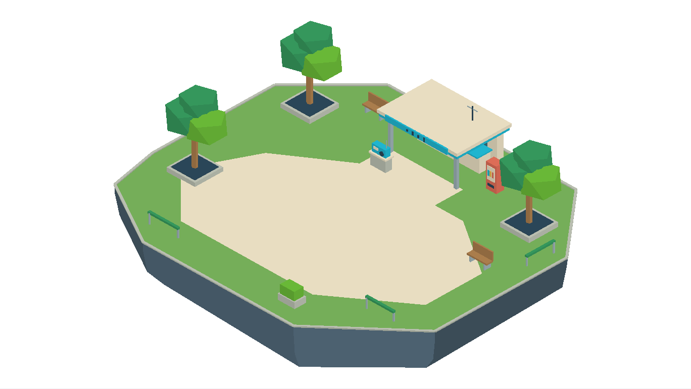
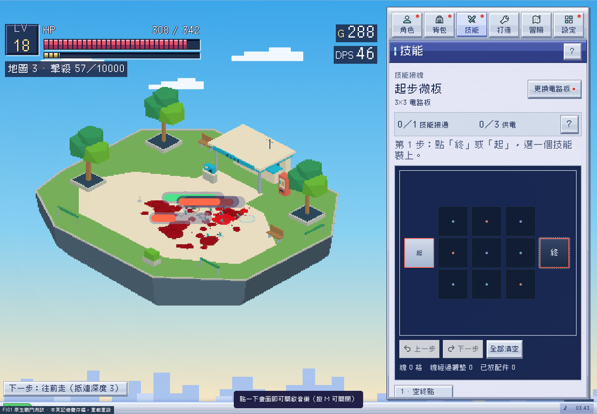

# FI01 綠蔭街角公園：第二張原生可玩浮島

2026-10-27，Asia/Taipei。Alan要求繼續下一步，依已確認的22場景名單製作第一章公園。FI01＋FI02目前為兩張模型／原生可玩候選，其他20張尚未製模。沿main4c90e05及同PR98，Claude仍4a5d1e4；未合併／未部署／未Release。



## 與唱片巷不同的設計

公園32×28米，削角後808.5平方米，比FI02約小15%。保留同一1.8米角色美術比例與7.858遊戲單位／米，島形及物件另行設計，不把唱片巷改綠色充當新地圖。

淺色廣場延伸一條通往後方候車亭的步道，外緣草坪可行走；三組樹蔭、公共收音機、長椅、販賣機與時刻牌留在外側。中央不放噴水池或巨大雕塑，首領有完整轉身空間。亭簷用青色裝置面板與幾何訊號條呼應Y2K，沒有表面紋理、笑臉或卡通貼圖。短護欄留四個入口，島底是淺厚切面基座。

公共收音機收到前街重複試音，阿夏請玩家沿唱片店標誌追查。只改本候選p0的既有地區手記呈現，沿FIELD_STORIES、STREET_NEIGHBORHOODS與storyFlags.p0；沒有新建NPC任務、改六章深度、重排BIOMES或另設進度owner。[journal-validation.json](journal-validation.json)核對公園／收音機／公園手記皆顯示，沒有錯用候船口文字或誤推章節。

## 圖片、模型與三視圖

原先嘗試Host ImageGen回傳403 Forbidden，沒有得到新AI圖片。此頁圖與素材概念圖均由**實際自製GLB**直接渲染，非AI概念、也非用平面圖貼模型；原始請求和失敗狀態保存在assets/concepts/floating-islands/fi01-corner-park，不改用其他付費服務。

[素材目錄](../../../assets/maps/fi01-corner-park)含彩色GLB、同拓撲白模、逐件可編輯Blend、layout、native匯出及來源雜湊。1192三角面、16語意mesh、1原始材質，零貼圖，portable GLB每份約113KB，明確KHR_materials_unlit／COLOR_0。

[頂視](top.png) · [正面](front.png) · [右側](right.png) · [白模](blockout.png) · [角色與巨型首領比例](game-scale.png)。全部由同一模型輸出，並非不同AI圖；跨圖各自適應畫幅，不能按像素當統一比例尺。

## 原生接入與調整

共用FI02已驗證的候選建置器，新增`--map fi01`參數：

```sh
blender -b --python-exit-code 1 --python tools/maps/build_fi01.py
python3 tools/maps/validate_fi02.py --map fi01
blender -b --python-exit-code 1 --python tools/maps/reimport_fi02.py -- --map=fi01
python3 tools/maps/build_fi02_review.py --map fi01
python3 tools/maps/build_fi02_play.py --map fi01
# repo HTTP8800提供後
ISLAND_TEST_MAP=fi01 ISLAND_TEST_ORIGIN=http://localhost:8800 node tools/maps/test_fi02_review.cjs
ISLAND_TEST_MAP=fi01 ISLAND_TEST_ORIGIN=http://localhost:8800 node tools/maps/test_fi02_native.cjs
ISLAND_TEST_MAP=fi01 ISLAND_TEST_ORIGIN=http://localhost:8800 node tools/maps/test_fi02_native_skills.cjs
python3 tools/maps/package_fi02.py /tmp/FI01-native-combat.zip --map fi01
```

部分工具／API保留fi02命名以兼容前批，**同一套程式讀取本張layout**，沒有複製第二套戰鬥引擎。地形範圍、格網數、地區profile、名字與遮擋節點改由資料讀取。原生6單位格網／BFS、update、技能、掉落、章節與serialize仍是唯一owner；原src／index／正式dist沒有改。

模型頁初驗發現長椅與護欄間有一格孤立點，已移動長椅，實際空間與碰撞一併修正；原首領入口也太近護欄，已改到[5,-6]米，沒有只依賴投影把不合適入口算通過。角色、最大首領3.8米保守半徑與四入口均用同一layout。三棵樹及亭子接既有遮擋淡出，私有材質可還原，不修改共用快取。



## 驗證範圍

- [asset-validation.json](asset-validation.json)及[Blender重匯入](blender-reimport.json)：unlit零貼圖、有限且非退化三角形、白／彩拓撲與位置一致、normalize保留binary、地面32×28米、16mesh。
- [模型／路徑驗證](runtime-validation.json)：細格全部連通、四入口、首領路線、路段與中央遮擋採樣、五視圖／390px。模型頁使用的展示格網不控制原生戰鬥。
- [native-validation.json](native-validation.json)：原BFS／Move／格角、60模擬秒戰鬥、掉落回收、首領位移、進出地圖、serialize還原、訓練／塔樓fallback及390px，含候選SHA。
- [native-skills-validation.json](native-skills-validation.json)：23基礎主動技能fixture、有限座標與邊界、實際樹木遮擋／私有材質淡出還原；不是所有卡匣與傳奇變體。
- [story-dense-validation.json](story-dense-validation.json)：24實體、六章首領進度與保存、offline／map不誤推主線。FI02另重跑原生導航／戰鬥／進出回歸，避免共用工具改壞上一張。

原生候選的普通場景暫共用本島，訓練／塔樓沿原有地形；不代表正式BIOME對應已全部遷移。進度與偏好只存本頁記憶體，重載重設；有serialize往返測試，但不宣稱真機／持久存檔／長時效能已完成。這是專案驗證素材包，沒有game-dev canonical package receipt。

下一張按故事進入FI03「橋下修理坪」。正式index註冊與版本整合須先核對Claude最新主線，這批不自動merge或release。
