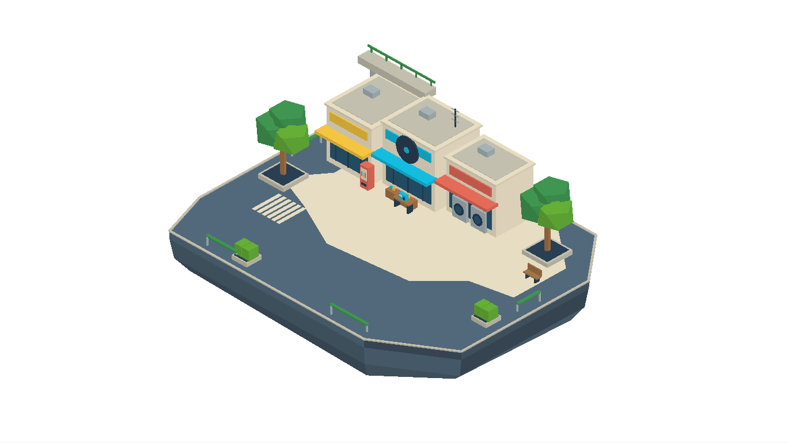
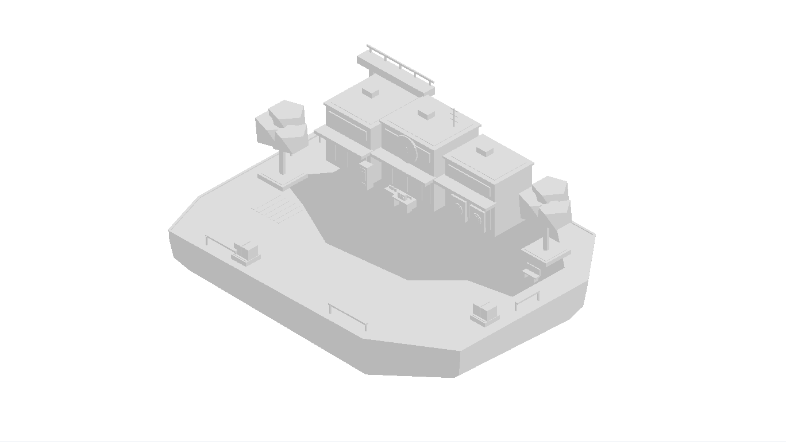
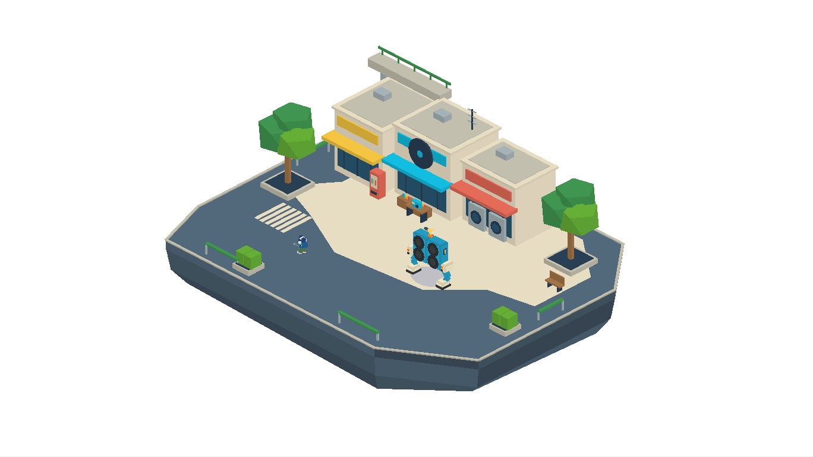

# FI02 前街唱片巷：第一張3D樣板

2026-10-27，Asia/Taipei。Alan已確認首張概念方向並要求繼續。PR98／codex/floating-island-redesign接續，基於main4c90e05，不動Claude4a5d1e4的技能／抗性／畫質候選。

**已產出可攜式GLB、同拓撲白模、可編輯Blend，以及同一模型的頂／前／右正交渲染。** 這是第一張模型與導航／尺度樣板，尚未替換正式遊戲地圖，不代表其餘21場景已製作。

## 模型

[素材目錄](../../../assets/maps/fi02-record-lane)：`fi02-record-lane.glb`（彩色）、`fi02-blockout.glb`（白模）、`fi02-source.blend`（逐件可編輯源檔）、`layout.json`、provenance及原始native匯出。模型1946三角面／14個語意mesh／1材質／零圖像貼圖，每份portable GLB約163KB。材質有明確KHR_materials_unlit，頂點色由COLOR_1提升到COLOR_0，幾何binary不改，其他GLB檢視器不需依賴本遊戲的特殊材質處理。

島體36×28米模型空間，削角地面實際面積954.5平方米；後側三店、唱片標誌、洗衣機、工作台、販賣機、樹、短橋段和管道都是實際幾何，並非把概念圖投到模型上。地面只兩大色塊，避免貼圖／AO／光照。底部不規則切面收邊，保留足夠島厚而不變成巨型尖錐。





## 三視圖

均由同一portable GLB、同一Three.js renderer輸出。各圖為適應畫幅而獨立置中縮放，**跨圖像素不是統一比例尺**；精確尺寸以layout／GLB米為準，不把這些圖當可量像素工程圖。

[頂視](top.png) · [正面](front.png) · [右側](right.png)。另有[遊戲鏡頭方向](game.png)及[角色／最大首領同框](game-scale.png)。沒有重新生圖造成的三視圖幾何不一致。

## 尺度與可走區

角色使用現有AKI GLB、原骨架與原遊戲縮放，測得約14.144遊戲單位高，定1.8米美術比例，故每米7.858遊戲單位；**沒有改原角色四肢、職業或實際遊戲屬性**。這個島映射後約283×220遊戲單位，介乎舊regular與large之間，取消任意種子抽成648跨度作首張設計基準，但尚未移除正式大小規則。

檢查4種普通首領形態、6章標記形態與3塔首領，全部用既有elite 1.3倍尺度。最寬者為第一章M04形態，視覺寬約45.31遊戲單位；採外接圓半徑約3.033米作保守導航檢查，不更改原遊戲碰撞半徑。其餘首領只作尺寸比較，不擅自成為FI02新敵人配置。

layout用同一建築box、街物circle／box、橋墩及護欄生成視覺與碰撞。店前預留1.6米碰撞延伸涵蓋箱子；後側六格孤立狹隙已加入實體花槽收邊，沒有只在測試中忽略壞格。

0.5米格網、0.8米島緣安全距離與0.38米角色半徑下，可走2352格，全部連通，保守可走面積588平方米（約61.6%全島）；比概念65–70%目標略低是加入島緣／角色留距後的結果，未冒稱達到原目標。四個普通入場點皆可到中心，最大首領指定入場點到主廣場路線可走；**沒有承諾最大首領能穿所有小巷或從四個普通入口入場**。



## 互動預覽

本機生成`dist/fi02-island-review.html`，自包含，不進正式bundle。可以切斜視／遊戲鏡頭方向／三視圖、純色／白模、顯示角色／可走區，角色自動循路或點地面指定位置；1–3倍縮放方便看角色。手機全島模式角色較小，可切近景；不因此把島盲目縮小。

本頁使用原生GLB reader、角色動畫、首領模型和桌機／手機鏡頭方向；**不是將FI02裝進terrainBuild，也不是完整戰鬥或原生AI導航測試**。路徑格網只存在預覽記憶體，正式接入須讓同一layout餵既有terrain lookup／BFS，不能留下另一套遊戲owner。全島framing是模型展示用途，不能拿它冒充已驗證正式跟隨鏡頭。原存檔只以記憶體代替，不讀寫玩家資料。

## 驗證與重建

- [asset-validation.json](asset-validation.json)：零貼圖、unlit、唯一節點、有限頂點、非退化三角形、白／彩位置與拓撲相同、normalize保留binary、layout與來源相同。
- [blender-reimport.json](blender-reimport.json)：兩份portable GLB實際重匯入Blender，14mesh、地面36×28及完整bounds核對。
- [runtime-validation.json](runtime-validation.json)：Chromium SwiftShader實際GPU匯入，原比例角色／13種elite首領候選比較、連通性／四入口／最大首領路線、路段插值及中央頭部遮擋採樣、五視角與390px；14個map draws，連角色共34。不是手機GPU效能認證。

```sh
blender -b --python-exit-code 1 --python tools/maps/build_fi02.py
python3 tools/maps/validate_fi02.py
blender -b --python-exit-code 1 --python tools/maps/reimport_fi02.py
python3 tools/maps/build_fi02_review.py
# repo HTTP8796啟動後
node tools/maps/test_fi02_review.cjs
```

## 下一步

先把FI02 layout接入獨立可玩地圖候選，沿既有terrainKey／lookup／BFS、敵人AI、掉落邊界及存檔owner；驗證真實移動、全技能預警、島緣掉落、清場、地圖返回與鏡頭後，才成正式地圖。外觀仍可沿此源檔精修門窗與地標，不再等待「是否批准最初方向」。然後依六章逐組製作其餘場景；目前不宣稱22張全部完成或已release。

game-dev CLI仍缺，本批以Blender、GLB靜態政策及Three.js檢查交付專案素材，沒有冒稱已取得該工具的canonical package receipt。未執行真機Safari／完整戰鬥／長時間測試，亦不把14 draws換算成手機FPS。
