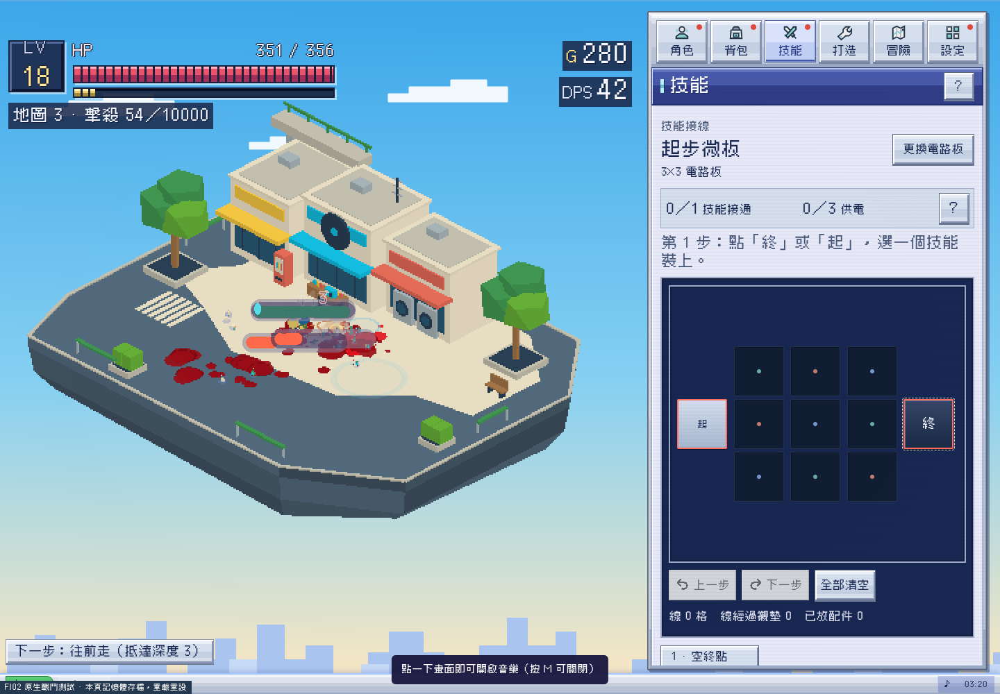

# FI02 原生戰鬥接入候選

2026-10-27，Asia/Taipei。Alan要求「繼續下一步」。同PR98／codex/floating-island-redesign，沿main4c90e05／v0.72.0製作可玩候選；未merge、未部署、未release，也未把Claude尚在4a5d1e4的v0.73／抗性候選覆蓋進來。

**現在可在FI02實際刷怪、走位、原生施技、打首領、撿物及進出地圖。** 這不是上一頁只有循路動畫的模型檢視器；仍是FI02專用驗收檔，不代表所有新地圖完成。



## 接入方式及唯一資料來源

`dist/fi02-island-play.html`由`tools/maps/build_fi02_play.py`生成，自包含／無外部資源請求，不提交20多MB的重複bundle。原`index.html`、正式dist及src遊戲來源**均未改動**；建置器將有逐處唯一匹配檢查的7項小修改套入候選副本，再在原06-main啟動前註冊FI02 adapter。源檔SHA-256、精確替換及最終候選hash見[native-build.json](native-build.json)。上游簽名有變就拒絕建置，不把舊源檔整包回寫。

這7項修改只讓原生Waypoint可接受指定plan、Move／怪物目標與重建投影選用角色或首領plan，以及GLB reader保留node.name供遮擋分組。核心更新、攻擊、技能、傷害、掉落、章節及存檔函式沿原生owner；adapter只提供地形、GLB呈現和邊界政策。這是review用接法，正式index註冊／版本整合仍待review。

`tools/maps/fi02-layout-runtime.js`是模型預覽與候選共用的尺寸／碰撞政策；layout中的建築、花槽、橋墩、護欄和地面色區同時餵視覺／碰撞／地面高度。世界座標為`[HX + modelX*M, HY - modelY*M]`，M約7.858；GLB Y向上。角色、骨架及原技能射程不縮放。

候選用原生6遊戲單位格網、terrainCell／Project／Segment／Waypoint／Move及既有BFS／routes快取，**沒有把模型頁的另一套循路系統拿來控制戰鬥**。生成lookup時對整格四角留空間，角色及掉落830格連通；較粗格網會按既有原則排除22個與主要區域不連通的小格，並記錄pruned數，不把它們當可出生／可掉落區。

首領使用同一地形owner的半徑派生plan；半徑3.8米由站立最大模型45.31×24.05遊戲單位的平面對角寬度，加上轉身／姿態餘量決定。這是保守政策，未證明所有動畫極值；原角色／Boss尺寸與數值不變。派生plan從指定主廣場選連通種子，而非要求巨物站在角色幾何中心的窄處。首領固定從layout指定入口進場，普通怪沿四入口。小巷不要求首領都能通過。

## 戰鬥、掉落與遮擋

- 原生update／spawnPack／hero AI／怪物AI／23主動技能照常執行。原生擊退有些在移動檢查之後改座標，故FI02每次update末端用同一plan投影回可走區；不改擊退或傷害數值。衝鋒／鑽地的直接位移亦在原skill tick後投影，避免跨出大體型安全區。
- dropGround／collectNearby沿用；島外及建築內落點由原生terrainProject拉回可走區。原生金錢合併／拾取規則不另寫，測試四批共12金幣全部收回。
- 模型把兩棵樹另拆成節點，map由14變16mesh，仍1946tri／1個原始材質／零貼圖。樹、三棟店及橋段接既有sceneryBlocksHero／updateSceneryOcclusion。需淡出時clone私有材質，離開遮擋後還原；不淡化地面或修改原材質快取。
- 正常世界及普通地圖在此**專用候選**暫共用FI02，方便驗證章節與進出；訓練／塔樓委派原有地形及渲染。`?island=off`可比較原地形。BIOMES索引與名稱沒有重排，因此部份原UI仍顯示原地圖名；不是已設計好21張新島。
- 存檔及偏好統一替換成頁面記憶體，重載重設，不讀寫正式瀏覽器資料。原生serialize／applySave有測，但不宣稱完成真實跨重載／離線持久化驗收。

## 驗證

- [native-validation.json](native-validation.json)：真實原生BFS／Move走四入口及首領路線、全部保守格角檢查；60模擬秒戰鬥／擊殺／移動；島外掉落投影及12金回收；首領技能位移與擊殺；enterMap消耗、abandonMap返回、serialize／applySave原map ID還原；訓練／塔樓地形fallback及390px無溢出。模擬測試可恢復倒下以繼續場景覆蓋，rescues有明列，不作平衡／難度結論。
- [native-skills-validation.json](native-skills-validation.json)：23主動技能分別用原生配板／castSkill／update／render，有限座標與地形邊界；樹木在實際可走格及支援的鏡頭yaw遮擋、私有材質淡出／還原。不是所有卡匣／傳奇變體矩陣。
- [story-dense-validation.json](story-dense-validation.json)：24原生實體、六次原生章節首領擊殺及保存到第六章；地圖及offline不錯推主線，未新增進度owner。
- 原GLB靜態政策、兩GLB Blender重匯入及模型頁複驗繼續保留在同目錄。draw counts只診斷，不當手機FPS證據。

```sh
python3 tools/maps/build_fi02_play.py
# repo根目錄開HTTP8797
node tools/maps/test_fi02_native.cjs
node tools/maps/test_fi02_native_skills.cjs
STYLE_TEST_OUT=docs/floating-island-redesign/fi02 STYLE_PREVIEW_URL='http://localhost:8797/dist/fi02-island-play.html?fresh&lvl=12' node tools/style/test_story_dense.cjs
# 完整素材＋兩種預覽包（先生成兩個HTML）
python3 tools/maps/package_fi02.py /tmp/FI02-native-combat.zip
```

## 待續

下一組先依第一章製作FI01綠蔭街角公園，沿已確認風格；之後按六章順序繼續其餘地圖。正式整合前需Claude review adapter與7項候選替換、核對其新主線，再決定常規地圖對應和index註冊。真機Safari、長時間效能、所有動畫姿態／卡匣變體與真實持久存檔尚未完整驗收；本次沒有自行merge或release。
