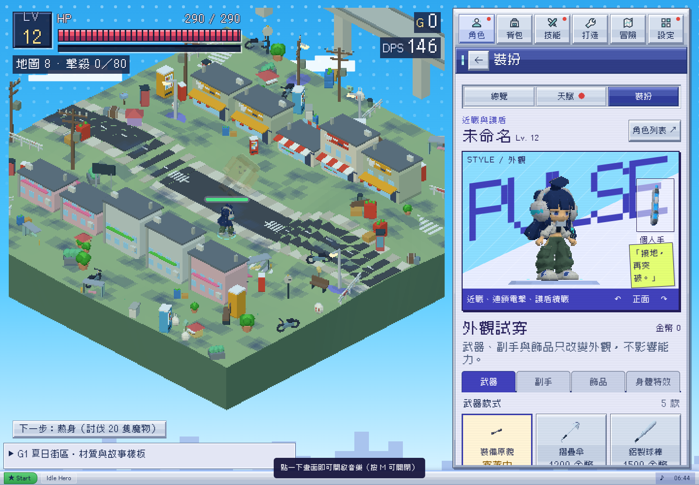

# G1 兩項修正交付

2026-10-26，Asia/Taipei。Alan要求繼續既有全遊戲優化，本批先收尾已批准G1的兩項P2。遵守src由Claude原型整合的協作分工：本分支只交付最小patch、回歸腳本與證據；沒有修改／發佈正式src。

- 原始基準：main `1d15538`（v0.60.0）。
- 本機修正驗證commit：`e36e96a`，只修改`src/game/04-render.js`，14行新增、1行調整。此commit只是隔離checkout的測試來源，沒有推為正式開發分支。
- 可接入修正：[g1-render-fixes.patch](../../tools/g1/g1-render-fixes.patch)。在相同base執行`git apply --check`後才接入；原型若已有新修正，以其最新分支為準，不覆蓋。
- 回歸腳本：[test_fixes.cjs](../../tools/g1/test_fixes.cjs)。來源由輸出JSON內G1_SOURCE明確標示。

## 修正內容

F1：把`g1On()`納入hero signature。既有設定handler清除terrain後，render會透過原owner移除、dispose並重建角色與裝備，不額外引入第二個狀態。

F2：face decal仍不進入emissive flash清單。第一次倒下時只收集該actor的Basic＋map材質，記下原始opacity，再套用與身體相同的淡出曲線；drone使用平方曲線，其他沿用線性曲線。M01共用unlit頂點色沒有map且有shared標記，不被這個修正改動。

## 驗證

- [修正前](baseline.json)：街區雙向開關及十種face actor淡出均可重現失敗，記錄34個具體檢查失配，不代表34個不同產品bug。
- [修正後](fixed.json)：全部定向檢查通過；兩個方向的材質與專裝切換、十類臉在deadT .1／.3／.4、受擊／凍結不拋錯、另一隻M01共用材質仍為opacity1。
- 沒有修改原GLB、骨架、角色四肢、物品uid、戰鬥傷害或掉落。這是軟體WebGL定向回歸，不是完整真機認證。



狀態：patch已驗證，待Claude接入正式來源後複驗，不宣稱已合併／發佈。全遊戲下一批提案見 [G2工作包](../g2-proposal/README.md)。

## Claude 接入與重現

在正式整合checkout套用patch後，先提交其來源，再回到本交付分支以該checkout建立隔離預覽：

```sh
# 正式來源checkout（先確認工作目錄與base）
git apply --check /path/to/delivery/tools/g1/g1-render-fixes.patch
git apply /path/to/delivery/tools/g1/g1-render-fixes.patch
# 提交後，在delivery checkout執行
python3 tools/g1/build_preview.py --source /path/to/integration-checkout --output /tmp/g1-fix-proof/index.html
python3 -m http.server 8783 --directory /tmp/g1-fix-proof
# 另一個終端，在delivery checkout
GAME_LAB_FIX_URL=http://localhost:8783/ node tools/g1/test_fixes.cjs
```

Builder也會更新delivery內的`docs/g1-summer/build-source.json`；驗證後須檢查該metadata，勿把暫存修正來源誤當正式已發佈來源。測試預設寫入本目錄fixed.json，正式接入後請保留其新commit欄位。

## Claude 已有修正，勿重複套 patch

Claude另修`ab3642b`，現候選`0c7d33b`／PR80。本輪已對該候選執行320及390寬度的同一組定向回歸，全部通過，證據見[320](claude/320.json)／[390](claude/390.json)。其修法把Basic納入fade清單，並為flash加emissive存在檢查；測試已改驗可觀察行為與受擊不報錯，不要求與本包的獨立清單寫法相同。舊patch只保留為原始交付證據，不再建議套在已修候選上。這次不涵蓋0.61新增背景續跑／小視窗等功能。
