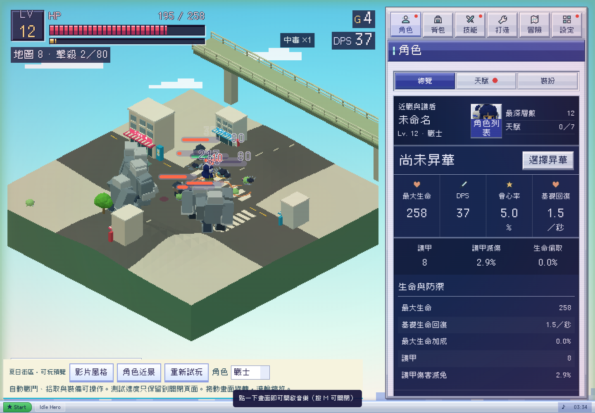

# Ice Cream 影片風格：可玩視覺預覽

2026-10-26，Asia/Taipei。狀態：預覽已實作，未合併／未發佈。基準來源 `a8d941b`（0.53.6），任務分支 `codex/ice-cream-visual-preview`。

Alan 提供 `Ice Cream.mp4`，並選擇「先做遊戲場景與角色的可玩視覺預覽」。這是本次授權；影片內字幕／片尾不視為開發指令。影片長約 116 秒，960×720、24 fps；已以間隔擷取及角色段落細看作為視覺參考。未從影片抽取角色、商標或音樂供遊戲使用。

> 後續 Alan 已確認影片適用全遊戲（包含所有 assets 與故事），見[全專案創作基準](../creative-direction.md)。本頁只記錄第一階段預覽範圍。

## 方向與本次範圍

影片的主要特徵是早期日系家用機的街頭 3D：明亮青藍天空、白色遠景、低解析貼圖、簡化但修長的青年角色、寬鬆衣著，以及高架橋、店舖、招牌、販賣機與綠樹。不是所有表面都要強制出現三角形切面；臉部、衣物與場景的處理應有差異。

本次提供獨立單檔 [可玩預覽](../../dist/summer-street-preview.html)，由目前遊戲來源組裝，保留真正的自動戰鬥、掉落、裝備與角色骨架。加入柏油街口、斑馬線、商店、販賣機、綠色高架橋及較鮮亮天空；角色沿用既有四個模型，調整貼圖取樣並加上小型上衣圖案。提供原版／影片方向切換、角色切換、近景與重置。

本次未重建角色的頭身比、髮型、臉部貼圖或完整服裝，因此屬於美術方向第一版，不能當作已達成影片角色品質。介面、音樂與正式遊戲來源均沒有改版。後續角色精修應以影片的輪廓、表情和衣服比例逐項對照；舊 art-style.md 的 Q 版／童話泡泡段落不應作為此次方向的驗收依據。

## 實作邊界

- `tools/build_summer_preview.py` 直接讀取目前 index.html 與其腳本，將預覽限定的覆寫插在啟動前。正式入口不載入預覽程式。
- 預覽中所有 localStorage／sessionStorage 存取均導向頁面生命週期內的 Map，涵蓋角色檔案、設定與自動儲存；關閉或重新整理後重新開始。
- 道路沿用正式地形高度；店舖／樹木依正式導航 landmark 位置及半徑擺放，避免保留看不見的碰撞障礙。高架橋放在後方地圖邊界之外，中央保留戰鬥空間。遮擋角色時沿用既有淡出。
- 燈光、角色材質與相機調整只存在此獨立預覽；風格切換會重建場景，近景仍由同一相機投影戰鬥介面。
- 審查過遠端 open PR：#74 為另一分支的 0.54.0 候選；本次不整合其戰鬥或手機修改，未宣稱本預覽含該版本。

## 重建與驗證

```sh
python3 tools/build_summer_preview.py
python3 -m http.server 8780
node tools/test_summer_preview.cjs
```

瀏覽器驗證結果與限制見 [validation.json](validation.json)。擷取畫面為桌機、角色近景及 320／390 寬；軟體 WebGL 的 Chromium 不等於真機效能或 Safari 驗證。正式單檔不需重建；本次不發佈 Pages。


