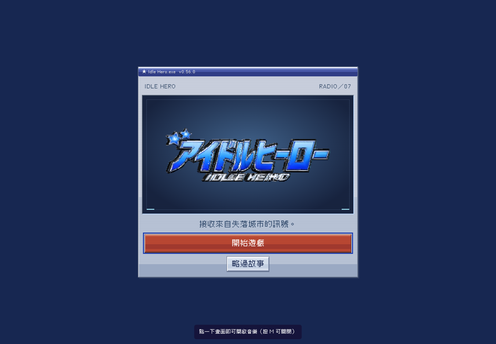
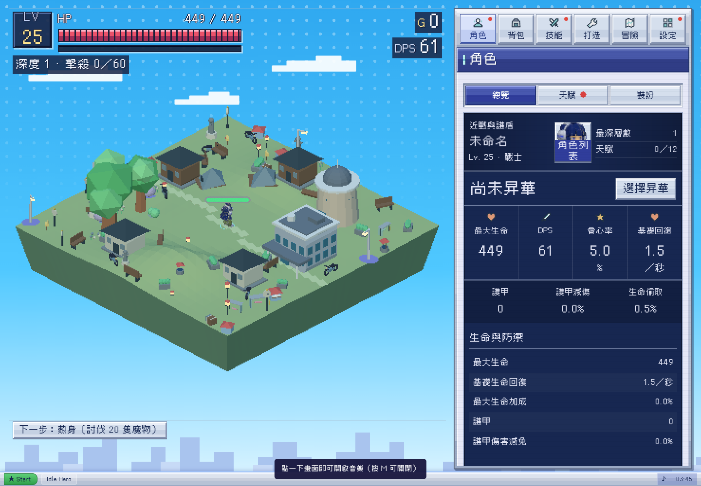
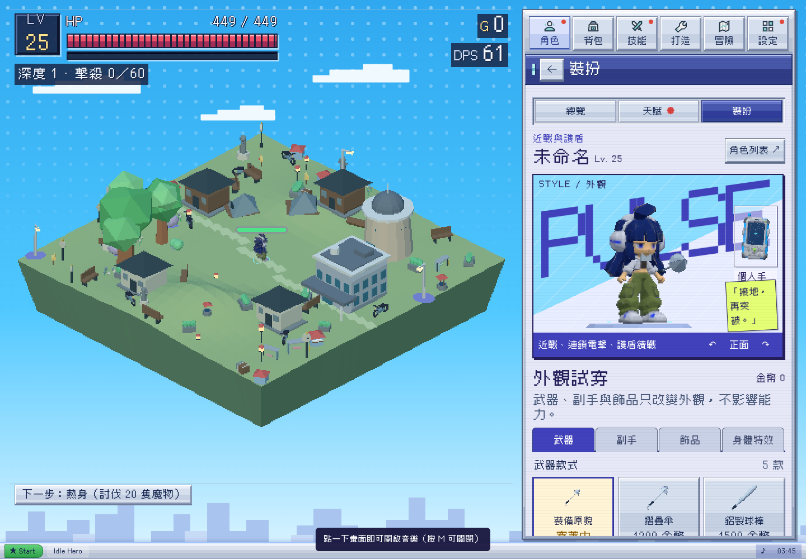
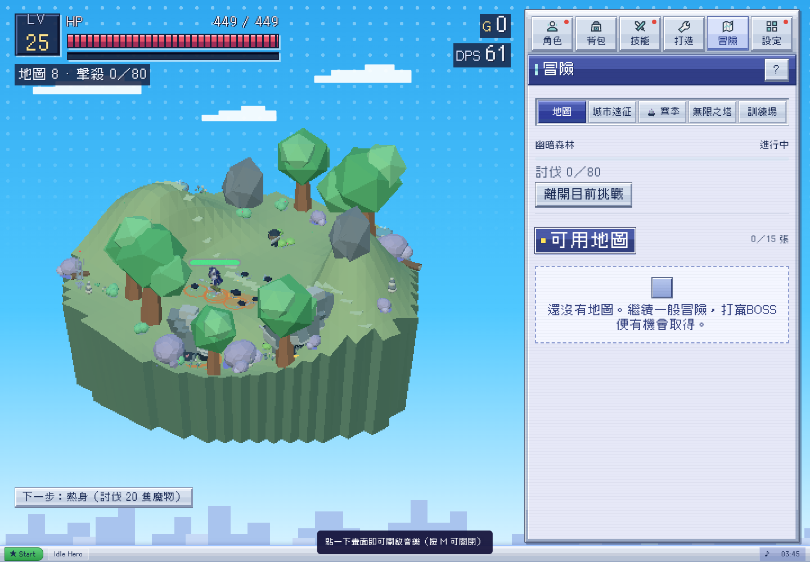
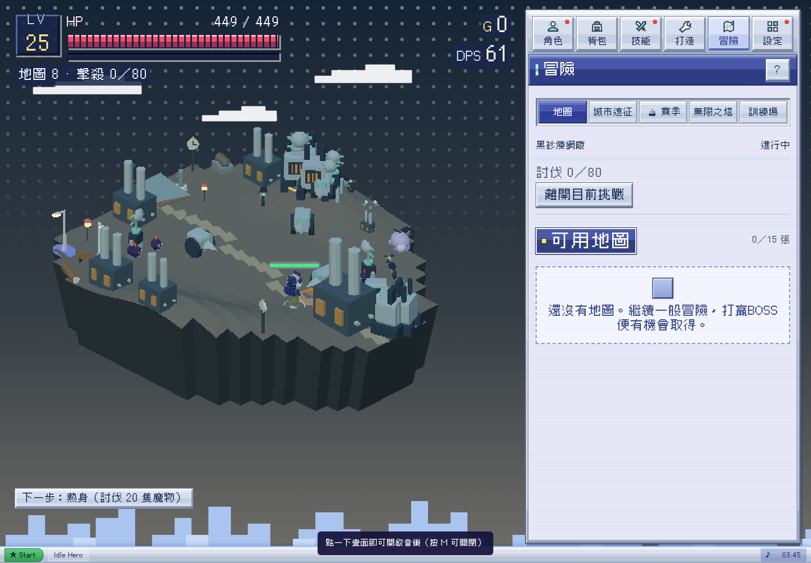
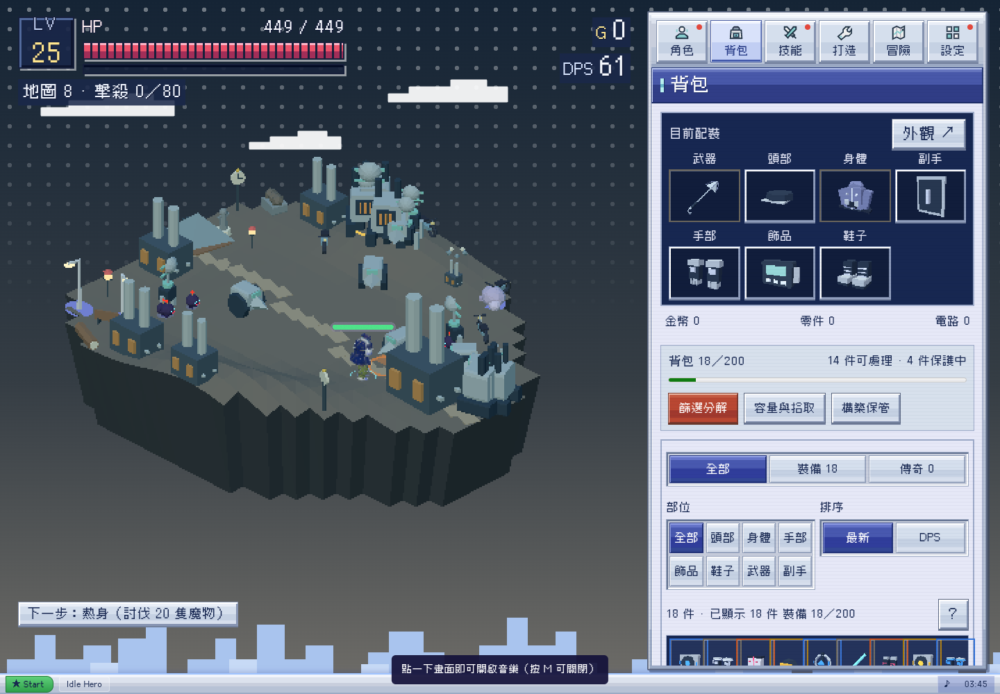
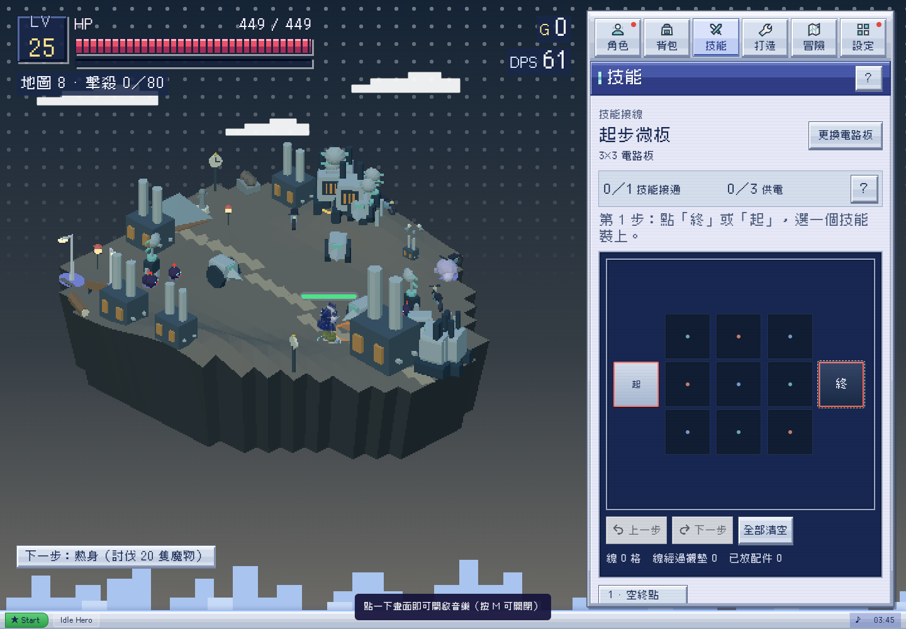
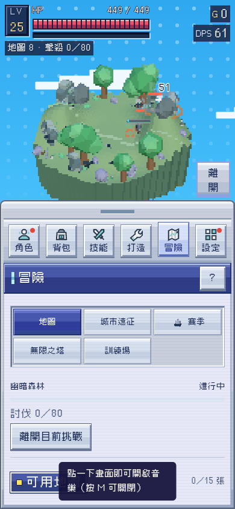
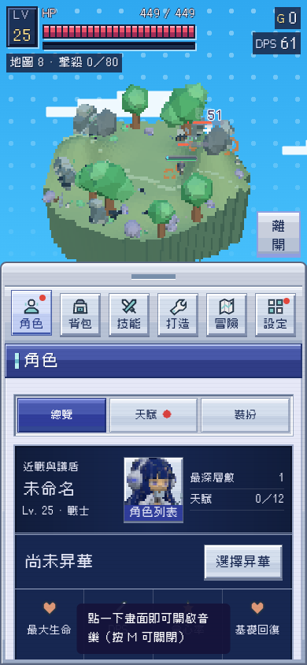
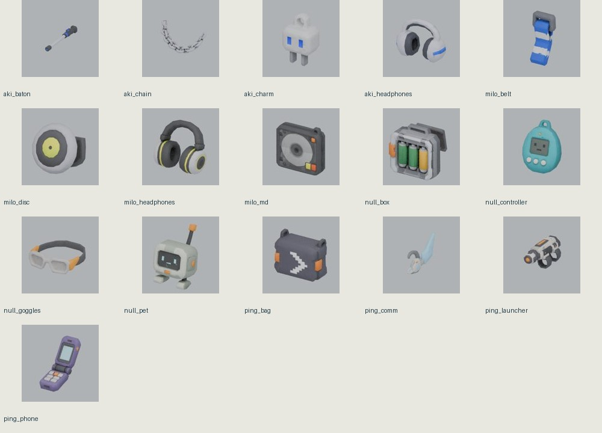

# 全遊戲創作審查與優化計劃

2026-10-26，Asia/Taipei。狀態：**審查與計劃已完成。Alan後續已批准日常城市／電台訊號失常故事及G1可玩街區樣板，正依分工製作；本頁保留審查時的來源與方案紀錄。**

最新進度：[G1交付與協作](../g1-summer/README.md)。下文「待Alan選」是當時提案狀態，G1門檻現已通過，未代表全遊戲或後續批次已完成。

## 先說結論

建議採「明亮街頭冒險」：保留既有戰鬥、構築與藍紫窗口介面，優先重整場景構圖、角色呈現、材質和故事的生活感。先完成一個真正能玩的街區樣板，再擴到其他地區與素材。單改天空、把所有東西加飽和，或立刻重做全部模型，都不足以解決整體落差。

第一輪獨立街區預覽只驗證了道路、商店、高架橋等元素能接進遊戲；仍是寬闊平台上的少量模型，角色材質、街區連續性和故事尚未完整建立，因此不作為後續美術品質的上限或正式規格。

## 一、已確認與仍待決定

Alan 本輪已確認：

- 明亮街頭為主，保留戰鬥冒險。
- 戰鬥背景由地區決定，不強制藍天白雲；夜間、室內、工業、雨景皆可存在。
- 戰鬥場景採主參考的色彩層次；UI 面板維持藍紫窗口風。
- 氣泡飄字只放戰鬥畫面內。
- **角色四肢比例先不動**。本計劃不以拉長四肢、縮放骨架或固定新頭身比作為改版起點。
- 其他可充分創作，可以提出大改，但實作前先問 Alan 意見。
- Claude 可參與所有領域。分工按批次與檔案認領，不永久切割職責。

仍待 Alan 對具體方案決定：故事保留多少斷線年代設定；戰鬥死亡／血跡的表現方式；是否按建議先製作一個街區樣板。以下具體題材、地區名稱及呈現參數都屬提案。

## 二、審查來源與範圍

| 來源 | 本次實際核對 | 不應混淆的狀態 |
| --- | --- | --- |
| 主參考影片 | 原片約116秒，間隔影格及角色／街區段落；分析影格保留內部研究區 | 影片沒有完整遊戲介面或遊戲劇情，不能據此聲稱特定故事已被確認 |
| 遊戲 main | `5c8e190`，0.54–0.56 系列整合；獨立 detached checkout `/workspace/Game-Lab-review` | 沒有將本分支基於0.53.6的預覽冒充最新 main |
| 本輪畫面 | 新擷取9張，桌機1440×1000及手機390×844；全部逐張檢視 | 代表性畫面，不是逐件裝備、全部地圖、全部動畫的完整視覺驗收 |
| Claude 程式分支 | `claude/project-thread-yw9jjp`／`38c6fb8`，已包含 main | 天空／日光、身體特效、血跡、系列與詞綴已在 main，不能重列為尚未做過 |
| Claude 文件候選 | PR #75，`d6be924` | 未合併的中性街頭美術規範，不是已發佈遊戲效果 |
| 另一聊天的怪物候選 | 「設計遊戲地圖與怪物」正在將已選三視圖製作為 Blender 樣本 | 本輪未取得／視檢其36張候選圖或最終GLB，不能宣稱通過；不推翻既有已選造型 |

擷取使用本機獨立 Chromium／軟體 WebGL；本次沒有可用的內建或擴充套件瀏覽器工具，不聲稱讀取使用者瀏覽器或正式站。擷取 manifest 無頁面例外。不包含真機 FPS、Safari、完整鍵盤／螢幕閱讀器或實際音訊試聽認證。

[畫面來源](capture-manifest.json) · [資料與角色模型盤點](source-inventory.json) · [實體資產清單](asset-files.json) · [runtime資產與封裝來源](runtime-asset-files.json)

### 素材盤點的實際數量

- `assets/` 共44個實體檔案；其中21個GLB＝4角色＋16裝備＋1品牌標誌。不是遊戲所有程式生成模型的總數。
- 已封裝4角色、16裝備模型。四角色各約1.4萬三角面、各9個動作片段；只是結構盤點，36個動作並未逐格檢查。
- `BIOMES` 共21筆，含18個一般地區及3個塔樓主題；`FIELD_STORIES` 12則。`NEW_MONSTERS` 的6種只是擴充類別，不是所有怪物總數。
- 正式角色貼圖目前使用 LinearFilter／LinearMipmapLinearFilter，與候選文件「最近點、不用mipmap」尚有差別。應做實際鏡頭下的A/B，不直接把整個場景紋理全部硬切到相同取樣法。
- 配樂有 drift／haze／rush 三種情境選曲，現有音源及來源紀錄可保留。本輪只核對檔案與切換邏輯，未判定聽感已貼合新方向。

## 三、按畫面逐步審查

### 1. 標題／進入遊戲：功能可辨，敘事氣質需調整

- 保留：品牌標誌、清楚的開始／略過故事、藍紫窗口框架。
- 落差：大面積深藍舞台與「失落城市的訊號」先傳遞孤寂和遺跡感，尚未讓人認識街區與居民。
- 提案：保留Logo，以有生活痕跡的街角／電台背景承接；「開始」先進入正在運作的城市，再讓異常成為冒險誘因。
- 風險與限度：靜態擷取不能證明動態減量或焦點順序合規；沿用既有關閉動態／音訊設定，不用新動畫延遲開始。

### 2. 角色總覽：資料清楚，人物存在感不足

- 保留：職業、能力與角色檔案的單一來源，既有裝備、核心及構築規則。
- 落差：戰場人物相對整座島很小，面部、衣服與裝備個性在日常視角消失；角色頁先呈現數值摘要，人物像縮圖。
- 提案：以鏡頭、構圖、材質、臉部與衣服圖案提升可辨識度；四肢骨架與原比例保持不變。角色頁可用既有3D舞台的構圖，不增加第二套角色資料。
- 可及性：小型身份資訊與數值需實測對比與縮放；不能只用髮色分辨四職業。

### 3. 裝扮／裝備：值得保留，需統一材質語言

- 保留：耳機、鏈子、播放器、摺機、電子寵機與現有裝備插槽，這些已是很好的主題資產。
- 落差：人物、硬體、程式生成武器與小圖示之間，表面細節密度不一致；部分模型在小尺寸只剩灰色塊。
- 提案：以同一套像素圖案、塑料／布料／金屬明暗規則處理；先完成一位角色及兩件裝備的遊戲內樣板，再批次套用。
- 可及性：稀有度與裝備狀態繼續保留文字及符號；資訊不依賴模型顏色。

### 4. 日間戰場：新天空已改善，核心仍像地形模型展示

- 保留：中央可戰鬥區、地形高度、導航與遮擋淡出、預警、拾取與自動戰鬥。
- 落差：大樹與岩石主導視覺，缺乏沿街建築、店面節奏及日常活動；參考中的層次來自前／中／遠景與街道關係，不能只以多放小物替代。
- 提案：保留戰場邏輯，以可連接的街道、路緣、店面、高架／樓梯與遠景建立場所。戰鬥區清楚，生活細節集中於街道兩側與安全背景。
- 可及性：不能用更密的招牌遮住敵人預警；不同元素仍需非色彩識別。

### 5. 工業／暗色地區：可保留，需亮暗分組

- 保留：工業、雨景、地下及夜間可作探索變化，不要求全遊戲白天。
- 落差：此樣本中角色、敵人與地面大多落在近似灰綠亮度，巨型敵人又佔去不少輪廓空間；全畫面天空點紋也未隨地區材質區分。
- 提案：暗背景＋中亮地面＋清楚人物亮部，以暖窗光、局部招牌或設備燈導視；氛圍暗不等於資訊暗。調整尺寸呈現與鏡頭時保留Boss威脅感。
- 可及性：夜間警示與血條須另量對比；靜態圖片不足以判定戰鬥中可讀性。

### 6. 背包：格網保留，小圖需要有用途的細節

- 保留：格網瀏覽、手動換裝、比較與分類；藍紫窗口皮膚本輪不推倒。
- 提案：物品圖示先建立「輪廓、材質、系列識別」三層，小尺寸先看得出耳機／播放器／零件，再看稀有度。統一封裝裝備與通用代用品的打光、角度及裁切。
- 限度：此圖以測試生成的18件物品作代表樣本，不代表掉落分佈或所有裝備均已逐件檢查。
- 可及性：保留文字詳情、選取框與裝備狀態，不把小圖或顏色當唯一資訊。

### 7. 電路板：主題契合，表現可以更有角色感

- 保留：玩家手動接線、起終點、供電與配件上限，資料仍由 GridLab 與 G.board 擁有。
- 提案：把機件包裝、玩家手機、電台與街區裝置形成同一產品語言；戰鬥技能用各自有辨識度的圖形，介面不套街頭塗鴉底紋。
- 可及性：三色線路之外需保留起終點、形狀與狀態文字；本輪未重測觸控接線或色覺模式。

### 8. 手機戰鬥：功能完整，但可見人物更小

- 保留：可調戰場與操作面板、既有把手／觀戰模式，避免推翻Claude近期手機修正。
- 落差：390寬樣本中整座島仍入鏡，角色與物件細節不足；初始音訊提示覆蓋部分面板。
- 提案：手機預設以局部街段與人物為焦點，另保留全景；提示移至不擋主操作的位置。這是鏡頭及資訊安排的方案，不改四肢比例。
- 可及性：待在320／390／430寬、字體放大與實際觸控下驗收，截圖不代表已完成。

### 9. 手機角色：版面可延用，需把人物與生活故事連起來

- 保留：身份、職業、角色列表及成長資訊的可達入口。
- 提案：短台詞、角色關係與當前街區事件從既有資料延伸；故事長文按需展開。小尺寸3D與人物圖需共享已確認外觀，不另生一套不相符的人設。
- 可及性：人物圖不取代職業文字；焦點、讀屏及窄螢幕長名稱需另驗證。

## 四、全部資產類別的處置計劃

下表覆蓋各系統的資產類別，不聲稱已逐件通過美術驗收。S＝小批調整，M＝需樣板及多鏡頭驗證，L＝跨素材與系統依賴；不是工期承諾。

| 類別 | 保留的資產／機制 | 計劃優化 | 證據／尚缺驗證 | 優先／量級 |
| --- | --- | --- | --- | --- |
| 4主角 | 身份／職業、骨架、四肢比例、存檔key | 臉部貼圖、衣料、配色分組、配件、人物鏡頭 | 4模型結構已盤；其餘角色需近景與全動作視檢 | P0／M |
| 人物動作 | 9種既有clip與攻擊時序 | 重心、待機、回頭、衣飾後續動態；不改命中時間 | 36片段逐項驗收待做 | P1／M |
| 16封裝裝備 | 模型、插槽、稀有度與專屬規則 | 塑料／金屬／布料層次、貼紙、剪影、縮圖 | 原件目錄與縮圖；穿戴穿插逐件待做 | P1／M |
| 通用裝備／代用品 | 物品uid、底材、詞綴、收藏與構築引用 | 常見品與傳奇品分級美術，先補最常見模糊輪廓 | 應從實際物品catalog映射，不只看GLB數量 | P1／L |
| 怪物 | 行為／命中／導航資料及已選候選造型 | 用機械、街頭物件及異常訊號建立類群 | 另一聊天12怪物候選與樣本待取得；不重畫覆蓋 | P0樣本／L全量 |
| Boss／塔樓生物 | 預警與招式、首領辨識 | 材質分層、局部焦點、機關與場地呼應 | 工業截圖＋程式；全型態待做 | P1／L |
| 街區建築 | 碰撞／導航規格、地區主題 | 模組店面、屋頂、立面、招牌、窗格、連續路緣 | 日間畫面顯示目前多為分散建物 | P0／L |
| 地面與地形 | 高度、可走範圍、坡道與邊界 | 柏油／磚／水泥圖集、磨損與路面導視 | 不得讓畫出的道路指向不可走區 | P0／M |
| 道具／植栽／遠景 | 現有合法資產與場景生成owner | 每區6–10種有用途小物、前中遠景、葉影／雲影 | 密度與批次繪製成本待量測 | P0樣本／M |
| 21地區資料 | 地區id、掉落／詞綴／塔樓規則 | 先分日間街區、港區工業、夜雨室內三個家族 | 不把21區全部套相同晴天色票 | P1／L |
| 燈光／天空／取樣 | main新天空日光、品質檔位 | 明暗層次、局部亮色、材質取樣A/B | 來源filter與候選規範有落差；不得僅改文件稱完成 | P0／M |
| 技能／受擊／死亡 | 技能判定、預警與資料上限 | 電流／紙片／聲波／火花的圖形區分，減少常駐遮擋 | 紅色液體血跡是Claude新實作；更改需共同確認 | P0樣本／M |
| 氣泡飄字／拾取 | 真實傷害與拾取結果 | 只在戰鬥內、數字優先、事件分層、避免遮住預警 | main仍可見描邊文字；不能把文件提案當已實作 | P1／M |
| UI／圖示／手機 | 藍紫窗口、Cubic11、六入口、既有觸控 | 小圖一致、降低冗餘裝飾、提高人物資訊比重 | 不整套改成另一種主題皮膚 | P1／M |
| 品牌／教學插圖 | 現有Logo、開始／略過及教學機制 | 同一街區題材的構圖與文案，不重造品牌 | 首屏敘事與主方向需接軌 | P1／M |
| 世界觀／角色故事 | 電台、卡匣、修理／音樂／傳訊／改裝線索 | 由「廢墟與系統描述」轉向居民、地點、關係與日常 | 序章3頁、角色4份、地方故事12則均需逐條改寫提案 | P0方向／L |
| 裝備名稱／圖鑑／任務 | 原id與數值來源 | 名稱、物件出處及短文案共用詞彙表 | 不批次換key，不製造兩套平行資料 | P1／M |
| 音樂／音效／環境聲 | 手勢解鎖、關音／音量、現有合法來源 | 日常節拍、夜間層次、招牌／電台／裝置音色，與戰鬥分層 | 需實際試聽A/B；本輪未聽感驗收 | P1／M |
| 宣傳／截圖／版本素材 | 真實遊戲可驗證內容 | 只用達標樣板的實機畫面；不把概念圖當成品 | 改版通過後才更新公開展示 | P2／S |

### 可保留的硬體素材示例

這些為儲存庫既有裝備參考縮圖，能證明題材基礎可用；不證明穿戴位置、動畫與遊戲縮圖已通過。優先把它們接成統一的世界，而非全部丟掉重建。

## 五、建議的敘事方案（待 Alan 選）

**推薦：保留電台／訊號／卡匣，把「城市已經熄燈多年」改成「城市仍有人生活，但各區訊號正在失常」。**

工作題材可為「街區電台復播企劃」：四種專長的人穿梭商店街、港區、高架與夜間街段，找回聲音、修好裝置並認識居民；異常訊號與失控機械提供戰鬥理由。這個題材是本次原創提案，並非影片本身的劇情。

- 開場範例：「下午三點，街角電台突然播出一段沒人點過的旋律。街上的機器也跟著亂了節拍。」保留神祕感，先讓玩家看見正在運作的日常。
- 角色短故事從生活與關係切入，再接到能力；不再只說「每七秒造成幾倍傷害」。戰鬥說明仍留在技能欄。
- 地區短文可由店員、維修員、搬運工、電台主持人等聲音帶出；採現有不打斷掛機的呈現方式。
- 港區、雨景、停電區與地下機房仍可陰暗；以地區狀態表現危險，不把整個世界一律末世化。
- 裂隙、塔樓、賽季、核心與裝備機制可先保留，以同一訊號異常概念重新串接；不因改故事重置玩家進度。

較保守的替代案：保留「停電後第七年」，改寫成已復甦的街區，舊停電只是歷史。改動較少，但序章須明確讓玩家知道城市仍有人居住。較激進的全新人設／全新主線留待後續；本輪沒有批准重設四主角。

## 六、分階段落地與每一關的驗收

### G0：這次先完成審查與選擇

交付本報告、資產清單、Claude協作紀錄、明確待決方案。Alan 回覆故事與樣板方向前，不開始遊戲程式、模型、故事資料的大改。當前已確認的六項限制直接遵守，不再重複要求確認。

### G1：一個能定風格的可玩街區樣板（推薦下一批）

範圍限制：1個街段、1位現有角色表面精修、2件既有裝備、1種已選怪物樣本、1套技能／死亡表現對照、3段故事文案提案。角色四肢與骨架比例不改；不一次替換全部地圖。

1. 先出街段佈局與材質／配色表：道路、店面、路緣、遮陽棚、高架或跨街設施、電線、遠景。放置須與導航及遮擋同步。
2. 角色用現有骨架與模型做材質、臉部、服裝圖案及裝備呈現精修；不重新設定四肢長度。先給近景／戰場尺寸兩種對照。
3. 怪物沿用另一聊天正在完成的候選樣本，先驗收尺寸、材質、轉軸與行為讀取，再整合；不是重新生成另一隻。
4. 提供原版／樣板A/B、遊戲內全景／跟隨鏡頭、手機預設視角；身體特效與血跡保留切換比較，等待確認效果。
5. 3段新故事先放提案預覽，與保留舊設定版本並列；未選之前不覆蓋正式文本。

通過標準：不看檔名也能分辨街區場所；主角不被背景與常駐特效淹沒；新裝備近景及戰場都有清楚輪廓；夜／工業可延伸同一材質系統；藍紫窗口維持；新場景可實際刷怪、移動與拾取。驗收未通過不批量生產素材。

### G2：人物、裝備與怪物的一致性擴展

G1獲確認後才做其餘3位主角表面精修及其裝備、建立全部物品→模型／縮圖對照，再接已選12怪物的製作清單。各角色9動作、7部位裝備穿戴與簽名配件逐項檢查，記錄使用代用品的項目。資料id、骨架比例、裝備uid、職業固定規則不因此更動。

### G3：地區家族與故事同步擴展

先做日間街區、港區工業、夜雨室內3個家族，再依現有21地區資料映射擴展。每家族有材質／光照／小物／遠景／音色表。把序章3頁、4職業故事、12地方故事及物品文案分批改寫；先提案後落檔，保持同一資料來源。塔樓及裂隙另驗其空間與戰鬥預警，不只換背景色。

### G4：戰鬥資訊、UI小圖與聲音精修

氣泡只在戰鬥內；先區分傷害、狀態、掉落三層，首領預警優先。保留藍紫窗口與Cubic11，統一物品縮圖／選取框／狀態呈現；不把所有控制變成貼紙。配樂及環境聲以實際試聽樣本決定，保留off／sfx／all以及手勢解鎖。

### G5：整合、回歸與正式發佈候選

重新fetch main與Claude候選，逐項記錄納入／未納入來源。回歸角色存檔、裝備／核心收藏、電路板、離線收益、裂隙、塔樓、手機把手與觸控、單檔與網站打包。再做實機畫面與效能對照，最後由Alan確認發佈。此報告本身不提供合併或發佈授權。

## 七、技術與美術驗收草案

以下是待樣板校準的門檻，不是既有量測結果。

| 面向 | 驗收方法 |
| --- | --- |
| 四肢比例 | 與G1來源模型比較骨架rest pose與各關節距離，不用畫面感覺推斷；全程不修改原比例 |
| 角色辨識 | 桌機與390手機的實際戰場尺寸檢視；先試相機讓人物約30–48 CSS px可讀，再依敵人密度校準；不是改模型比例 |
| 色彩層次 | 各地區看原色與灰階，分出背景／地面／角色／警示；70/20/10可作起始分組，不是影片量出的硬規則 |
| 貼圖 | 最近點與現有filter做近景／遠景A/B，檢查文字、摩爾紋、閃爍與裝備細節；UI文字不進低解析3D buffer |
| 街區空間 | 畫出的道路必須可走，導航障礙要可見；20次邊緣路線與遮擋情境作樣板檢查，再依差異補案例 |
| 戰鬥資訊 | 依目前真實敵人上限與Boss場景驗證，預警不被氣泡／身體特效／掉落遮住；不為美術擅自改上限或戰鬥數值 |
| UI／可及性 | 320／390／430／1440寬、字級放大、長名稱、鍵盤焦點、減少動態；一般文字目標4.5:1、大字3:1，須實測不能由截圖認證 |
| 效能 | 先量同機器同場景baseline，再比較draw calls、三角面、記憶體及幀時間；真機持續測試後才談30/60fps目標 |
| 進度相容 | 舊存檔及多角色round-trip，物品uid／收藏／板型／離線收益相同；只做美術不改獎勵 |
| 來源一致 | 角色、故事、道具名及圖示共用canonical資料；每資產有來源、製作檔、輸出檔及替代關係 |

## 八、Claude協作與衝突處理

已在 [PR #75](https://github.com/yauchai2/Game-Lab/pull/75) 留言，並收到 [Claude確認](https://github.com/yauchai2/Game-Lab/pull/75#issuecomment-6407719650)。這是本次實際協作證據，不宣稱其他聊天會自動讀取。

| 目前這一批 | 認領範圍 | 狀態 |
| --- | --- | --- |
| Codex | 本目錄審查、盤點、方案、驗收；creative-direction與接續紀錄的本輪決策 | 文件工作，未動遊戲程式 |
| Claude | PR #75既列的art-style／README／DESIGN／backlog及舊文件清理 | Claude確認範圍不再擴大，未動本審查目錄 |
| 另一怪物聊天 | 12怪物已選圖及第一個Blender樣本 | 不覆蓋、不重做；素材交付後進共同驗收 |

這不是永久所有權。批准G1後任何一方都可認領任務；動手前在共同PR／紀錄說明工作包、base commit、檔案、輸出與驗收，對方確認不撞檔再並行。渲染、狀態、故事canonical來源一次只讓一方整合；另一方用獨立素材／patch／工作樹交付。合併前重新fetch，不覆蓋對方的未提交內容。

Claude提供的內部研究路徑 `/mnt/project-files/internal-research/art-style-ref-video-2026-10-26.md` 在本環境不存在，本輪未讀取，不冒稱已採納其內部參數。公開規劃以中性設計語言表達；原片分析影格保留在本機內部研究區。

本計劃是此次範圍與里程碑，不另建全專案待辦。批准工作包後由共同 `docs/backlog.md` 追蹤；本輪不搶寫Claude已認領的backlog區塊。

## 九、現在請 Alan 給意見的兩個具體選擇

1. 故事更喜歡「城市仍有日常，電台訊號失常引發冒險」（推薦），還是「保留停電後第七年，城市已逐步復甦」？
2. 下一批是否按G1先完成一個可玩街區樣板，並提供死亡表現A/B（既有紅色液體／依敵人材質的油墨火花與訊號碎片），確認後才擴展？

目前六項已確認限制保持有效。等Alan回覆這份具體計劃後，再開始對應實作。
