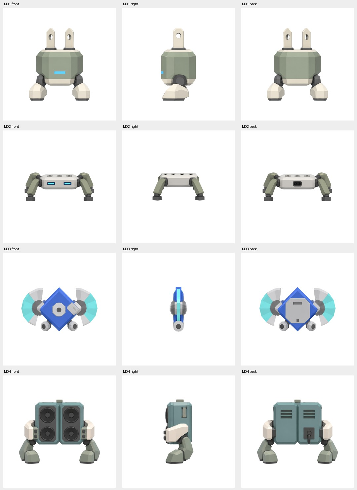
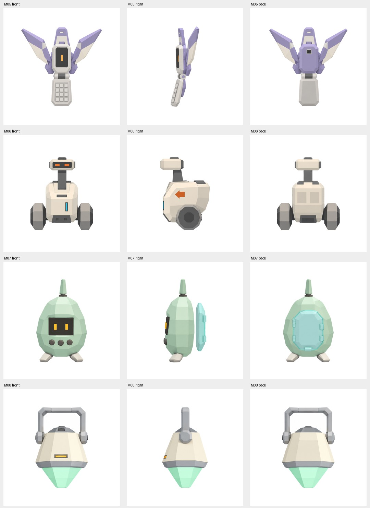
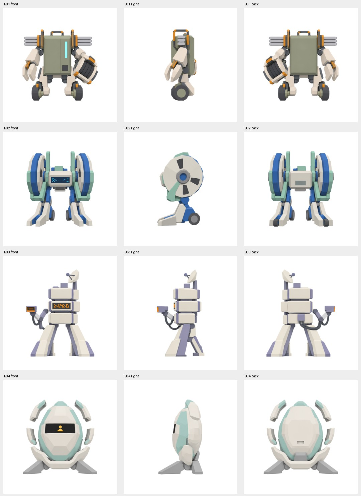

# 十二隻精怪：影片新風格適配審查

2026-10-26，Asia/Taipei。來源為Alan本輪上傳`Idle-Hero-12隻怪物-36張獨立視圖.zip`；已查看全部十二隻正／右／背共36圖。原始PNG原樣保存於[素材目錄](../../assets/references/monster-concepts/)，[manifest](../../assets/references/monster-concepts/manifest.json)記錄ZIP及各圖SHA-256。只審圖，沒有重畫、建模、替換正式遊戲或改AI。

## 後續規格更新

Alan已要求unlit／matte／no texture detail，故下文增加貼標、網罩圖案、刮痕等表面細節的建議已被取代；以幾何、純色面和動作表達物件特徵。M04新版候選見[交付](../../assets/concepts/m04-revision/README.md)。保留以下內容作原圖審查歷史，不再依舊貼圖建議建模。

## 判斷

**整套具備相容的題材與低面數結構，但未達原樣整套採用的程度。** 參考影片的關鍵不只低面數，而是可生活的城市、明亮有層次的色彩、鮮明局部色、青年街頭個性，以及具體物件／圖案構成的生活細節。影片未展示這些敵人；怪物題材是我們對「訊號失常引發冒險」的原創延伸，不能說是影片已確定設定。

這套以家用／音樂／通訊硬件為共同語言，是可用優點；但大量灰橄欖、米白、薄荷與薰衣草色，加上方孔／細燈／厚腳的重複，容易偏向同一套玩具機械。材質大多同樣霧面、低對比，欠塑膠／金屬／橡膠／透明殼的區別。需增加每種物件本身的辨識細節及少量鮮色，不必把全部洗成高飽和色或貼霓虹邊。

## 逐隻建議

| 圖中ID與名稱 | 適配判斷 | 保留與修訂 |
| --- | --- | --- |
| M01 插頭跳豆 | 可保留，表面精修 | 插腳、機身、厚腳已清楚；灰綠主體需更清楚色階與局部鮮色，加入少量原創電器標示／接縫。已有GLB不需為此全部重造。 |
| M02 拖板爬蟲 | 優先候選 | 日用品辨識直接、低矮輪廓適合街面；插孔與開關位置需在小尺寸可讀，增加電源線／開關等有功能的識別細節，避免只是白盒加機械腳。 |
| M03 MD滑翔盤 | 題材可留，輪廓中度修訂 | 音樂媒體很契合；目前藍色菱形與左右扇片較像抽象飛行機械，需加強MD外殼／標籤／滑門辨識及側面厚度，小尺寸不能只剩藍色符號。 |
| M04 低頻箱蟹 | 優先候選，建議首隻 | 音箱與城市音樂／電台關係直接，四個喇叭口可讀；保留剪影，加少量鮮色框、網罩與原創店家貼標，避免變重裝軍用機甲。名稱叫蟹不代表可直接套現有crab AI。 |
| M05 摺訊飛蛾 | 優先候選 | 摺機、鍵盤和展翅有個性；紫／米白可以保留，但翅片需更像手機或街頭配件的延伸，改善飾品／仙子感。動作可用摺合與振動，避免直接套通用拍翅。 |
| M06 錯址速遞車 | 優先候選 | 輪子、方向箭頭、運送用途最有街區生活感之一；可用店家色、運單／編號與更有辨識度的貨艙，減少泛用服務機械人的感覺。 |
| M07 存檔游魂 | 中度調整 | 掌上裝置、按鈕、顯示屏可留；蛋形薄荷殼與小腳較像可愛寵機，需加強真實硬件外殼／掛繩／接口與「訊號出錯」的性格，避免普通小寵物感。 |
| M08 補丁燈籠 | 適合特定街區，中度調整 | 提把與燈罩有生活用途；下面綠色尖錐像寶石／懸浮能源，宜改為可讀的燈光與透明燈罩關係，採維修燈／夜市燈具語言；不把所有透明部分視作已可直接用的材質。 |
| B01 總掣工頭 | 可留，需場景化 | 電箱、電纜、工業結構有合理來源；增加維修編號／警示／可讀開關，減少肩部武裝感，放在維修或供電場景更合理。 |
| B02 回帶港務機 | 可留，中度調整 | 捲盤與播放屏可連到聲音主題；目前巨輪／雙足機甲感較強，需把磁帶、捲線或港務用途說清，讓動作與場景交代它為何存在。 |
| B03 無主分揀塔 | 較大修訂 | 疊盒、衛星碟、掃描器有功能潛力；現時細長腳與層疊炮塔剪影偏科幻守衛，需加強包裹／滾輪／分揀標記及城市工作設備的輪廓。 |
| B04 未登出者 | 較大修訂，後置 | 裂開蛋殼與浮游碎片的科技遺物感較抽象，欠街頭物件來源；若保留為後期Boss，先確立它原本是哪種城市設備與故事來源，再決定外殼／碎片，不只改配色。 |

這些等級是美術工作判斷，不是假裝客觀量分。畫面未經正常戰場像素尺寸／動畫驗證；紙面三視圖也不能當作幾何閉合或動畫可用證據。各圖比例經置中縮放，不能直接用PNG高度推導怪物的遊戲尺寸。

## G2-A 必須更正的對照

之前的啤酒箱牛、井蓋地鼠、電線團蛛、便當盒蟹來自當時的接入題材提案，**不在此ZIP中**。不能把那些名字硬配到這十二張，或把現有type與新模型視為已確認的一一對應。已修正g2-monsters契約與backlog，停止以舊映射作建模依據。

推薦以M02／M04／M05／M06作為四隻優先候選，先出M04的表面與配色修訂比較，再和Alan／Claude確定實際type及動畫接法；此為具體建議，尚未變成新的四模型定稿批准。M01保留作對照，不算重新製作一隻新素材。B03／B04後置到場景／故事來源定清楚再做。

## 聯絡表

以下是縮小排列供審查的原圖聯絡表，不是新生成設計或3D渲染。原始36圖均保留。

