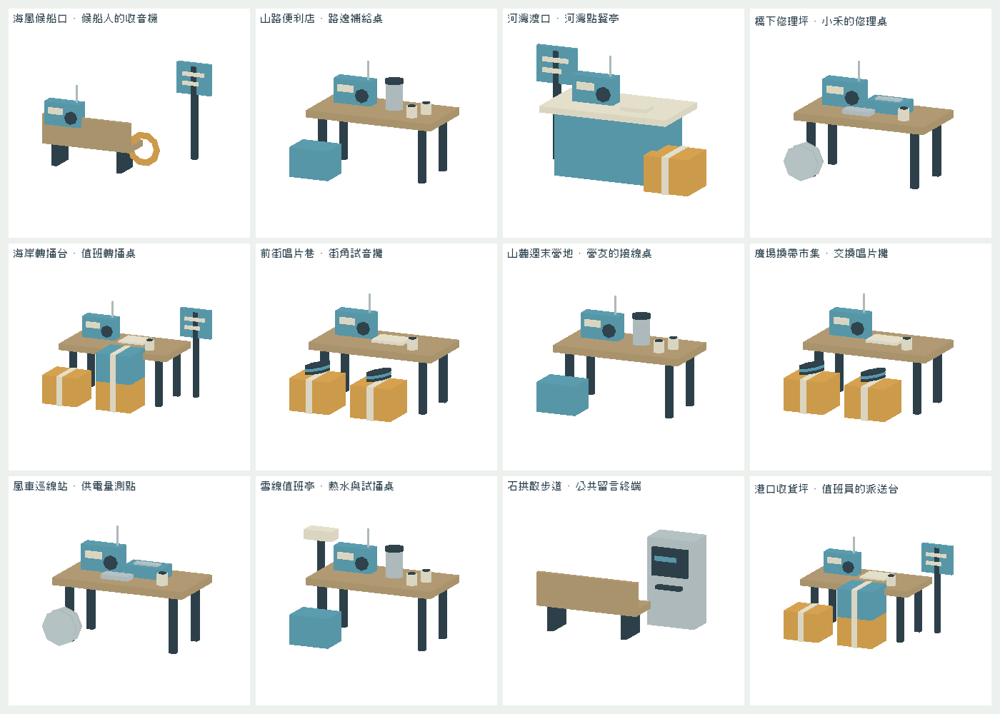
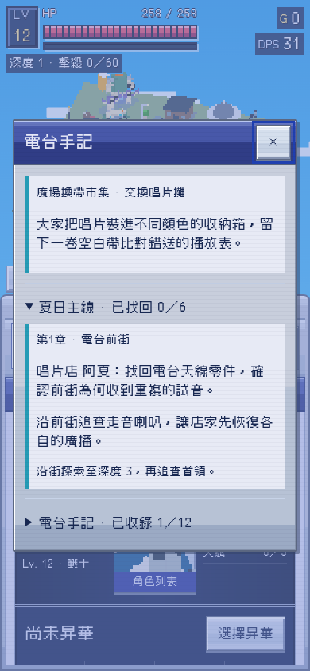

# 街區生活工作點與六章故事收尾（候選）

2026-10-26，Asia/Hong_Kong。Alan要求繼續整體更新。已同步main d06be7b／Claude PR86及其v0.65.0裝備、怪物輪廓、手機／掉落／血跡修正，音訊與本批場景仍在PR88候選，未再發佈。

## 原片與場景

再次對照Ice Cream.mp4的店面出入口、街頭陳設及年輕人生活氣氛（含25秒附近的店門與行人路）。承接的是設備仍有人使用、物件有日常用途的場景語言；依Alan後續規格採unlit、純色、chunky、無圖像貼圖。不把白底素材展示當遊戲世界，也不把影片內容當操作指令。

十二種程序式地景各有一個地方工作點：候船收音機／便利店補給／河灣點餐亭／橋下修理桌／海岸轉播／唱片試音／營地接線／換帶攤／風車量測／雪線熱水桌／公共留言終端／港口派送台。現有地區與地形索引保留，新模式的地景顯示名與地方留言呼應。

這些是靜態生活陳設，不是NPC對話AI、可拾取物、商店交易或新增任務。使用既有terrainBuild放置與lookup碰撞owner；中央戰鬥區外先找平整且不與原地標重疊的位置，才保留12×12腳印。之後沿原BFS整理可行走區，角色不會穿過桌子；進入／切換地形時仍用原terrainProject。候選無合適位置便略過，不強塞。

新模式每地形最多一個工作點；原版風格、訓練場和塔樓不新增。工作點沿現有occlusion fade與材質合批，不新增逐幀NPC AI。工業區明確排除舊地標替換分支，避免工作點被替換成大型機器。

## 故事

六章沿同一STORY_CHAPTERS／storyFlags.ch，深度仍為3、7、12、18、25、35；增加contact、request、lead等展示資訊，不建立平行進度或存檔欄位。

- 阿夏找回天線，從試音中的車鈴追到橋下。
- 小禾找回車鈴並隔離回音接口，從錯頻餐牌追到夜市。
- 收音機回到老闆娘手上，餐牌背面的時間連到車站。
- 麥克風恢復報站，線索指向忘了撤下的試音排程。
- 用鑰匙修正發射機排程，保留店家的供電及日常。
- 屋頂各站輪流試音，失物各自歸還主人；不再把車鈴、麥克風等全部裝進天線，也不把故障寫成時間停止。

實際「電台手記」先顯示目前地景的工作點／日常，再展開當前主線的委託人、目標和方向。地圖中清楚提示回到街區接續主線，避免誤以為地圖首領也推進六章。completed章節沿原手記顯示，不加戰鬥彈窗。

## 驗證

- [validation.json](validation.json)：120種子／全部12地景，118個找到工作點，兩個因空間／坡度不符略過。所有仍有中心可走且全區連通；工作點中心不可走，離戰鬥中心足夠遠。訓練／塔樓／舊模式排除。
- 12工作點原生渲染、修理坪／唱片巷／港口實景；實景key及profile與計畫相符，工業區也真正走工作點renderer。圖為現有程序式地形上的新增工作點，不冒稱十二張全新手工地圖。
- 實際directJournal手機視窗無水平溢出；六章contact／request／lead、同一ch存檔往返、深度閘門及完成訊息通過。
- [story-dense-validation.json](story-dense-validation.json)：24實體街區、六次原生主線boss kill依序推進並保存；地圖／離線不推主線。
- [blood-face-validation.json](blood-face-validation.json)：保留Claude 0.65的40處血跡／90秒壽命，體型比例及道路高度複驗。沒有用舊10處／12秒設定蓋回去。
- [site-validation.json](site-validation.json)：新0.65基底分檔網站390px啟動。10gameplay、stable-data對d06be7b及新音訊播放／模式回歸均通過。

新工作點有少量碰撞足印，導航已回歸；這不是零行為影響的單純換色。沒有新NPC或布料／人群動畫，仍未宣稱真機FPS、Safari或全遊戲最終美術與音訊聽感驗收。其餘限制沿單一backlog，不能把首輪release或本候選當作全部需求結案。

重建：`python3 tools/build.py`、`python3 tools/style/build_preview.py`，以HTTP8788提供後跑`node tools/style/test_neighborhood_scenes.cjs`。整合預覽dist/street-style-preview.html的進度只在頁面記憶體；試聽頁仍可由tools/build_audio_review.py產生。
