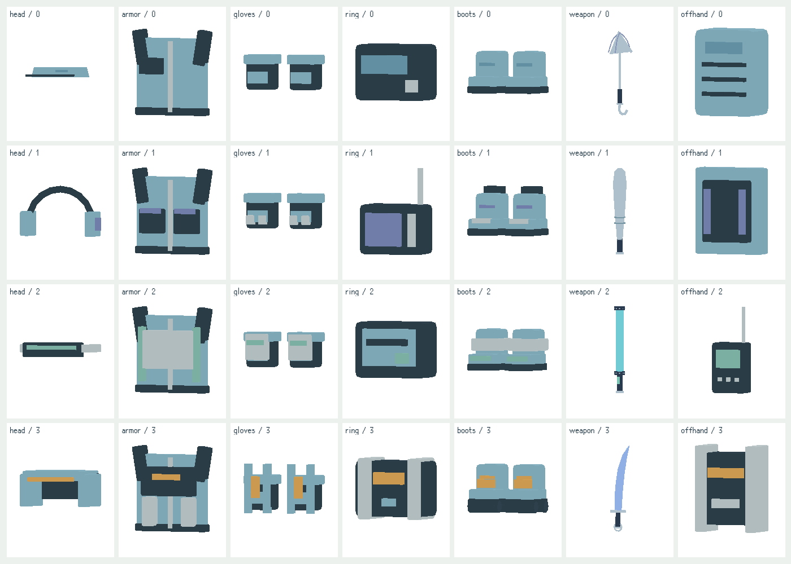
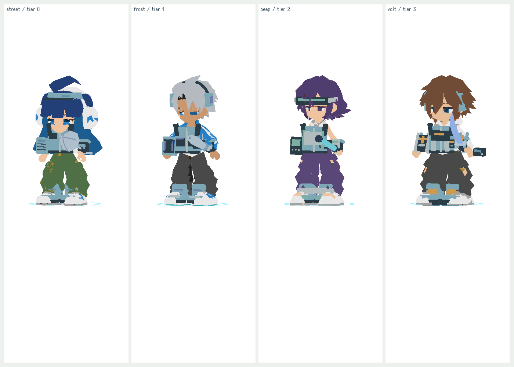
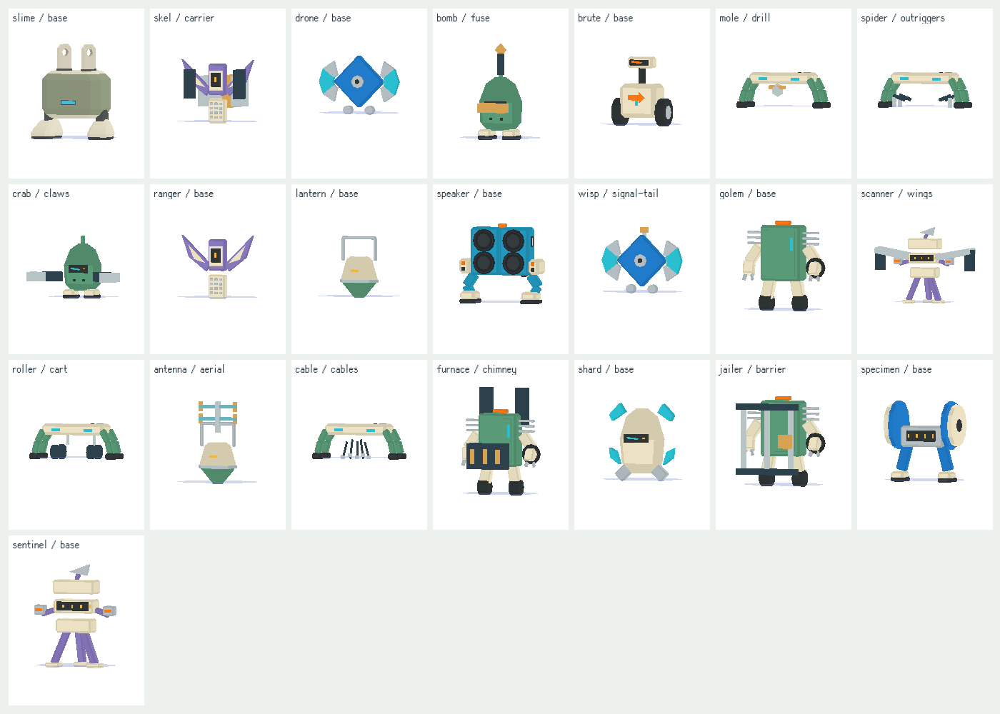

# 一般裝備一致性與共用敵人輪廓精修

2026-10-26，Asia/Hong_Kong。Alan再次要求繼續。沿codex/street-equipment-finish／PR88，接續四件專屬裝備GLB；本批是已實作／驗證的候選，未合併／未發佈。Claude最新b28dc60仍處理角色列表頭像，本批不改其列表CSS。

## 一般裝備

原先背包使用較完整模型，穿戴使用另一套簡模；掉落時除了武器／衣服，其他部位多半是一個圓環。現在`ordinaryEquipmentModel`為共用幾何owner，背包／角色穿戴／地面掉落使用同款造型：七部位×四階，共28組，含四款既有精修武器。稀有度提供四套配色，共112組可渲染組合；不是112件獨立GLB。

- 頭部：帽簷、厚耳罩、感應護目鏡、開面頭盔；不直接用大方塊蓋住整張臉。
- 胸部：街頭背心／口袋、護板與收納模組，下移掛點避開口鼻。
- 手套／鞋：單件隨對應骨骼，收藏顯示一雙；調整尺寸，避免完全藏在原服裝內。
- 配件／副手：呼叫器、探測器、卡夾、電池盒、音箱／護板／接收器等硬件輪廓。
- 112張無GPU備用圖由同一原生模型渲染，獨立hash腳本；補正四件專屬裝備在傳奇圖示失敗時也應使用新圖的路徑。

## 敵人輪廓

仍然是原有十二GLB，不冒稱新增十二款獨立GLB。針對共用基底的十二種普通敵人添加無貼圖、純色的硬件幾何，保留原Idle／Move／Hurt；模組隨整體移動，不是新的骨骼動畫。

| type | 輪廓差異 |
| --- | --- |
| mole / spider | 前向鑽頭／側向支腳 |
| roller / cable | 車輪推把／懸垂電纜及插頭 |
| skel / ranger | 運輸箱與外架／原薄翼輪廓 |
| wisp / drone | 訊號尾翼及高天線／原滑翔盤 |
| bomb / crab | 引信／寬鉗 |
| antenna / lantern | 高橫桿天線／原手提框 |
| furnace / jailer / golem | 煙囪及爐格／前方攔柵／原工頭機殼 |
| scanner / sentinel | 寬展翼／原高塔身 |

每個新模組合成一個頂點色mesh，幾何按type共用；材質沿既有per-actor clone，死亡淡出／異常染色不影響其他敵人。Boss及六章標記沿原owner，沒有套普通變體。新增部分納入現有轉換後bounds，血條、護盾、血跡按實際造型計算。每隻受影響敵人增加一個mesh，不聲稱零效能成本或真機FPS驗收。

## 驗證及界線

- [runtime.json](runtime.json)：112裝備組合零maps、新模式Basic材質、掉落max-span5；112 fallback與四專屬傳奇fallback匹配；22type含12模組、單隻死亡不污染另一隻。
- [healthbar-validation.json](healthbar-validation.json)：34組實際SVG血條／盾與新模型bounds對照，含章節Boss、精英、浮游、衝刺／落下及原版fallback。
- [blood-face-validation.json](blood-face-validation.json)：新候選實際1×／2×／4×體型與全部血跡blob比例、路面高度及無笑臉檢查。
- [site-validation.json](site-validation.json)：新分檔網站390px、資源載入、頭像及風格切換檢查。
- stable-data測試對main fd4ed11精確比對戰鬥、職業、地區／章節及SAVE_KEY；只正規化前批四件已完成模型的pending／舊警告文案，數值、owner、掉落池均同源。10既有gameplay通過。
- 四專屬GLB的36clip／兩模式／fallback亦重驗通過，原始使用者模型及四肢／骨架未改。

圖片是原生渲染與目前佩戴狀態，仍可見服裝／頭髮與新裝備的局部相交；未假稱逐姿態穿模全部解決，也未做cloth或真機Safari驗收。未把22type全部變成22個獨立GLB。場景敘事及聲音的剩餘精修仍在FINISH-04／05，整個專案不標完成。

重建：`python3 tools/build.py`、`python3 tools/style/build_preview.py`。以本目錄HTTP8788提供後跑`node tools/style/test_street_refinement.cjs`；備用圖用`capture_ordinary_icons.cjs`與`pack_ordinary_icons.py`重建。HUD／血跡測試可設`STYLE_PREVIEW_URL`和`STYLE_TEST_OUT`，避免誤測舊工作區。
