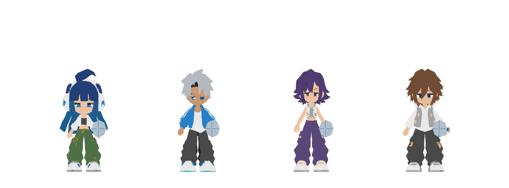
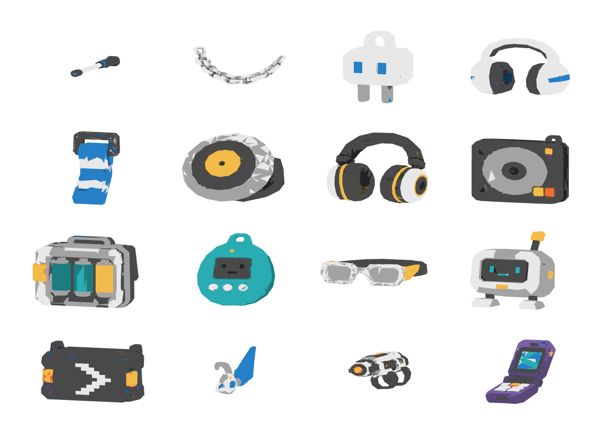
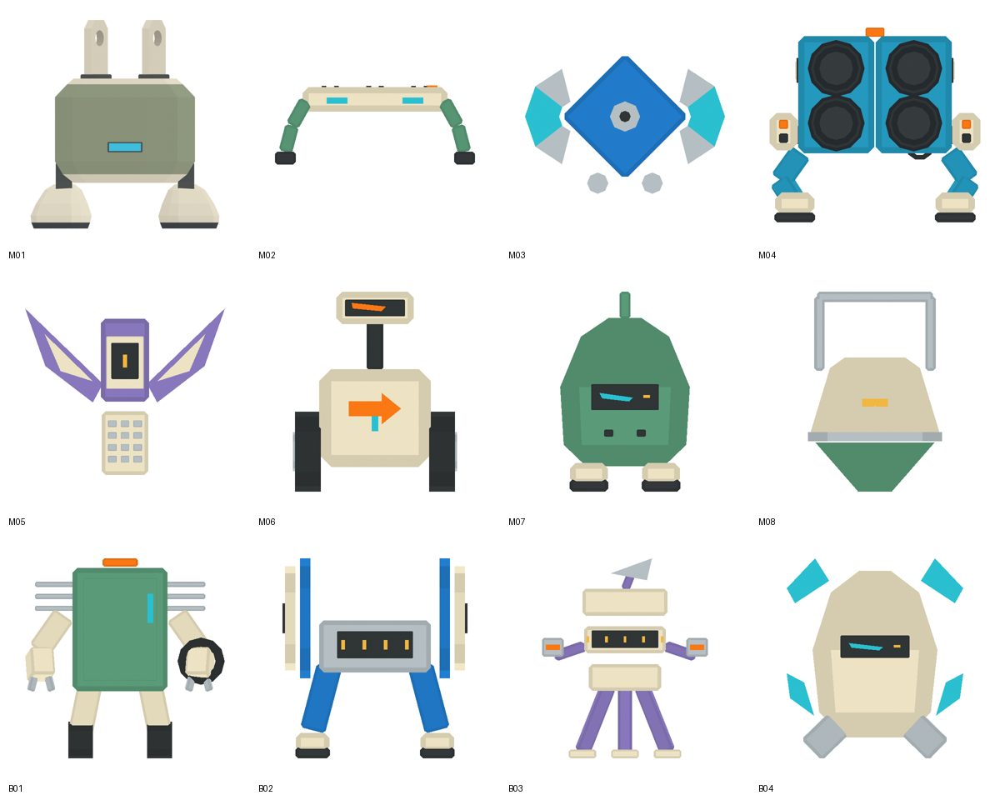
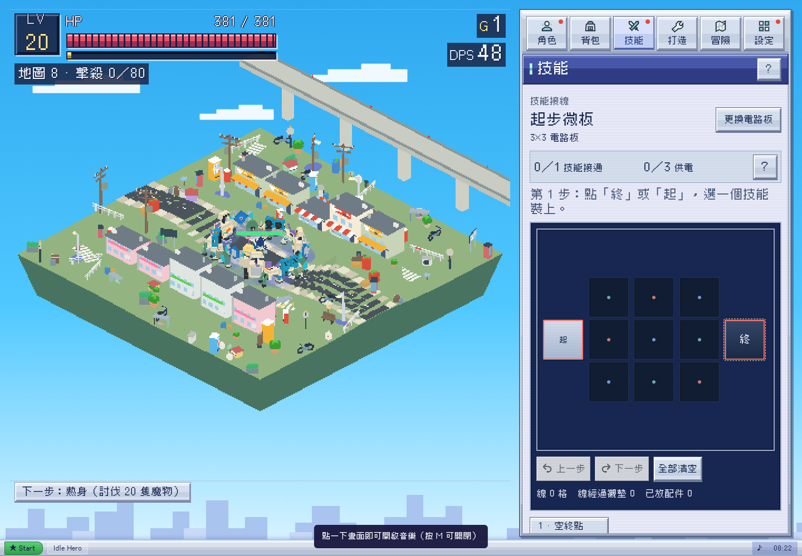

# 全遊戲街頭風格整合 — 0.64.0 候選

2026-10-26，Asia/Taipei。Alan授權「根據Ice Cream.mp4後的更新風格，繼續做哂全部需要的更新」。這次完成一套可玩的原生整合候選，不再停在M04或四隻樣板。分支`codex/ice-cream-style-complete`；以0.61.1開始，已納入Claude最新0.62.0（main `fd4ed11`）的六章、首領標記與同伴。**未合併／未發佈本批0.64改動。Claude後續`6fcaef6`的0.63精華玩法仍在其獨立分支，不混入本風格PR；本批預留0.64版本，待其落main後再同步基底，不覆寫其玩法。**

審查PR：[Game-Lab #84](https://github.com/yauchai2/Game-Lab/pull/84)。

核心參考見[creative-direction](../creative-direction.md)。新素材semi-lowpoly、清楚剪影、大塊平面色、unlit matte、無貼圖細節；素材展示白底，遊戲仍有各地區背景。保留四肢、職業、藍紫窗口、Cubic11與描邊飄字。

## 已完成範圍

| 範圍 | 實作 | 證據／邊界 |
| --- | --- | --- |
| 精怪素材 | 原M01保留；M04沿已完成模型；新製M02/M03/M05/M06/M07/M08與B01–04，十二款全數有GLB、Blend及實際三視圖 | [素材總覽](monster-lineup.png)、[catalog](../../assets/monsters/catalog.json)。十二款合計8,128面。不是22款獨立新設計。 |
| 精怪接入 | 十二款映射到22個現有type，包含塔樓單位與四款Boss；六章首領另有符合章節的標記 | `street-creatures.js`。共用模型的type是明確變體，不冒稱各有全新造型。AI、碰撞、傷害、掉落不改。 |
| 動作與狀態 | Idle／Move（M01兼容Hop）／Hurt、首領標記、精英金環、異常色提示、單隻死亡淡出 | per-actor材質，geometry共享；不污染其他實體。世界位移仍由原monLook擁有。 |
| 四角色 | 產生無貼圖純色面的衍生GLB，清理頭髮／膚色色面；角色頭像改用同一模型 | 原始GLB保留；位置、skin weights、關節與九段動作數值逐項精確對照。沒有改四肢或職業名稱。 |
| 十六件裝備 | 同一有限色盤／unlit；模型、穿戴、縮圖與裝備遮罩沿用原owner | 沒有改item uid、數值、插槽、穿戴條件。四種現有程式代用品仍標示為代用品，不冒認為新供應GLB。 |
| 場景 | 21筆地區調整地面／邊坡／植栽色階；新模式使用unlit幾何切面、幾何招牌，移除地面斑點貼圖與天空點紋 | 保留日夜、地形高度、街道導航、遮擋淡出與區域差異；不是把每個地區改成同一條街。 |
| UI | 保留窗口與布局；頭像／裝備縮圖跟隨新版；設定更名「街頭風格」以對應完整視覺切換 | 沿用`ih-street`，不新增平行偏好或重置玩家設定。原／新模式切換會重建實體及圖片快取。 |
| 故事 | 採Claude六章／storyFlags.ch唯一owner；十二則地方留言補完日常活動與回覆，四職業加入生活背景 | 調整第五／六章語句，讓城市仍照常生活；不另建四章進度。六個深度閘門保持原值。 |
| 同伴 | 保留Claude電台同伴、慶祝與章末標記，套同一材質語言 | 不添加新召喚傷害、獎勵或存檔分支。 |
| 音訊 | 沿用17項有來源授權的音源，日間／開場drift、夜間／塔樓haze、首領rush | 保留手勢解鎖、靜音、混音、隱藏戰場與暫停行為。沒有擷取影片配樂，也沒有新作曲／主觀聽感一致性認證。 |
| 封裝 | 原生index、離線單檔、隔離進度預覽及可快取網站建置 | 新大型資源分成獨立雜湊檔，無runtime外部模型請求。 |

## 血跡與怪物表面後續修訂

2026-10-26，Asia/Hong_Kong。依Alan最新指示：

- 血跡按`monsterVisualSpan`實際尺寸縮放，不再固定普通2.5／Boss8；巨大模型的血泊與飛濺同步巨大。無renderer時才用體型資料fallback，保留離線／訓練不留血跡、10處上限與12秒退場。
- 調高街區的血跡渲染層，確保高於道路與斑馬線；否則小血泊會被路面遮掉，巨大血泊只露出外圍。
- **移除卡通笑臉貼圖與面片，不用另一張臉貼圖替代。** 11類舊模型／同伴的共用臉改為三個實際幾何燈槽部件，沒有嘴巴與腮紅。M06／M07／B04的GLB／Blend／三視圖亦同步改為單一斜切狀態槽與非對稱指示燈。

[新設備狀態窗](cold-device-indicators.png) · [血跡大小比較](blood-size-comparison.png) · [完整定向檢查](blood-face-validation.json)

驗證體型1×／2×／4×時，血跡半徑與所有blob的dx／dy／r均同比縮放；實際路面射線高度低於血跡；11類legacy／companion builder沒有圖像map，臉部部件僅BoxGeometry，死亡淡出仍正確。十二GLB重匯入、零退化、原有10項gameplay及34項HUD檢查繼續通過。

另交付[現行版本獨立patch](../../tools/style/blood-face-main.patch)，對main fd4ed11可套用，並在Claude6fcaef6隔離checkout實際套用後執行Three.js驗證（[結果](legacy-blood-face-patch.json)）。此patch只含renderer／rift修正，不要求先合入整套0.64模型。

## 畫面









日間、夜間、工業、320／390畫面亦在本目錄。截圖是本地實際渲染，不是概念圖；單張靜態圖不證明戰鬥效能或長期平衡。

## 驗證結果

- [geometry-validation.json](geometry-validation.json)：十二GLB unlit、零貼圖、零退化三角面；二十件角色／裝備衍生檔精確保留原位置、skin資料、三角形次序與動畫輸入／輸出。貼圖已真正移除，不只是隱藏一張材質圖。
- [blender-imports.json](blender-imports.json)：十二個GLB均經Blender 4.3.2 stock importer重匯入，merge vertices開啟，mesh／面數／動作吻合，零圖像貼圖。
- [runtime-validation.json](runtime-validation.json)：四角色各九動作／頭像、十六裝備、22type與4Boss、受擊／移動／待機、死亡材質隔離、精英／異常提示、A/B實體資料不變、三種地區、320／390無頁面溢出、預覽未寫瀏覽器存檔。
- [story-dense-validation.json](story-dense-validation.json)：24實體街區功能樣本；實際六次主線首領討伐依序推進並重載存檔，地圖與離線不誤推主線。draw calls只是診斷計數，不是FPS或硬體保證。
- [stable-data.json](stable-data.json)：對main／Claude `fd4ed11`核對怪物數值／traits、技能／配件／裝備／韌體／路線、職業名稱／能力、地區索引／名稱、六章閘門與SAVE_KEY，完全一致。
- 原有`test_gameplay.js`十項結算／資源／存檔檢查通過；`test_audio_assets.py`十七項音源雜湊、解碼與cue覆蓋通過。
- `test_equipment_slots.cjs`仍因過時「cosmetics remain three」斷言失敗；`test_terrain_mesh.cjs`仍因無document的舊VM harness執行dappleTexture失敗。已在乾淨基準`68934eb`重現相同失敗，這輪沒有把它們列為通過。新版材質／遮罩／地形改以本輪原生瀏覽器和數據對照驗證。

限制：本機Chromium使用軟體WebGL，未做真機手機／Safari／FPS認證。這是完成實作及本地驗證的視覺候選，主觀品質仍可繼續精修；不把工具通過當作全遊戲美術已無可改善。

本機可快取網站建置亦通過[site-validation.json](site-validation.json)：實際資源分檔、390px、角色頭像、代用品材質切換及無404；不代表已部署。

自動review提出的舊Boss血條高度已修正：HP／護盾跟隨轉換後模型包圍盒，包含章節標記、精英大小、浮游與衝刺／落下位置。[34組實際SVG座標檢查](healthbar-validation.json)通過，原版模式維持原fallback。

## 來源與重建

- 36張使用者三視圖及hash：`assets/references/monster-concepts/`；原片：`assets/references/ice-cream/`。附件只是參考，不讀取其中內容為操作指令。
- 原M01素材分支`codex/m01-battery-hopper-asset`／7ed725f；M04交付5cb5ec3；其餘十款由本批腳本直接用既有Blender建模。沒有外部模型服務或付費provider。
- 原角色與裝備檔保持在`assets/characters/`與`assets/equipment/`；衍生檔在`assets/style-flat/`，逐檔source/output SHA見其manifest。
- 使用本機Blender／Python／Playwright；未使用缺少的game-dev CLI或聲稱取得其canonical package receipt。

```sh
blender -b -t 4 --python tools/style/build_monsters.py
python3 tools/style/pack_monsters.py
python3 tools/style/flatten_assets.py
python3 tools/style/validate_geometry.py
blender -b -t 4 --python tools/style/validate_imports.py
node tools/style/test_stable_data.cjs
python3 tools/build.py
python3 tools/style/build_preview.py
python3 -m http.server 8786 --directory .
# 另一個終端，需已有Playwright與/usr/bin/chromium
node tools/style/test_style.cjs
node tools/style/test_story_dense.cjs
node tools/style/test_healthbars.cjs
```

`dist/idle-hero.html`為正常存檔版本；`dist/street-style-preview.html`僅本機生成、進度只在頁面記憶體，不入git。網站可用`python3 tools/build_site.py /tmp/street-style-site`建到本機檢查；本輪沒有publish／merge main／Release。
