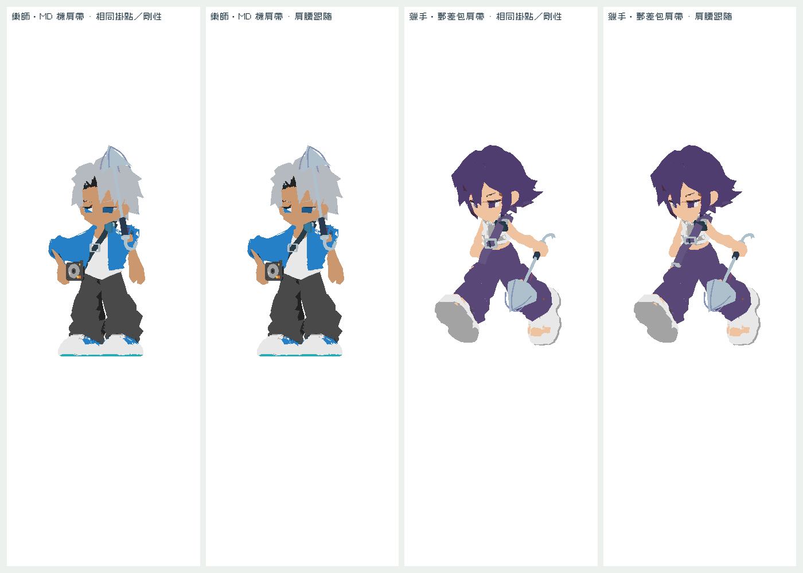
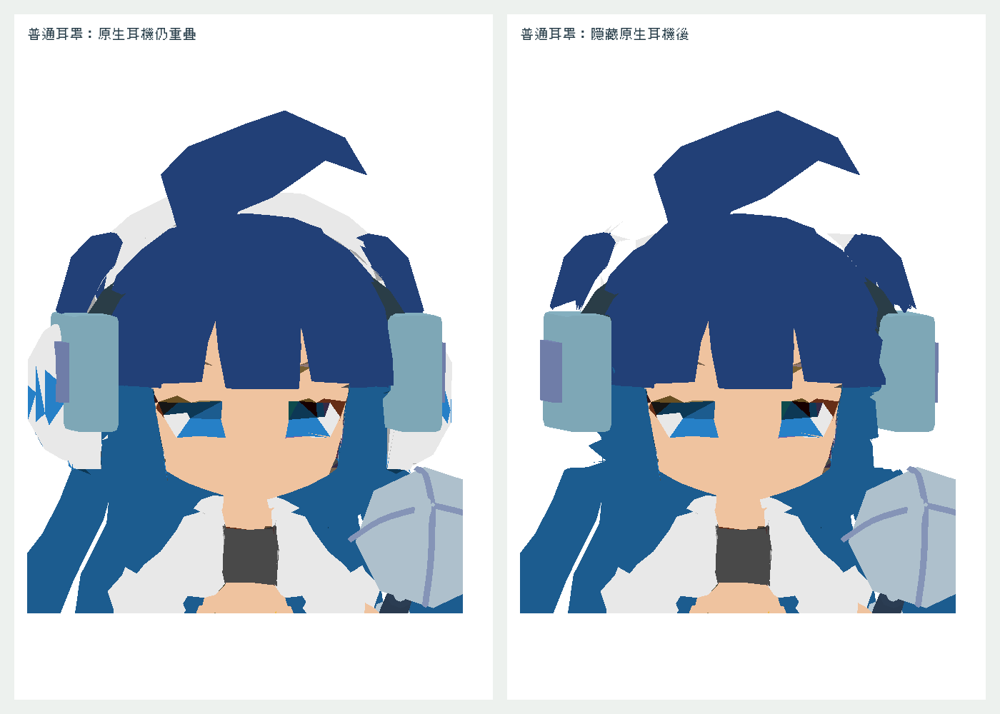

# 肩帶與普通耳罩佩戴收尾

2026-10-27，Asia/Hong_Kong。分支 `codex/street-wear-fit-final`，基於正式 main `4c90e05`／v0.72.0。本批已實作及本機驗證，待 PR review；未合併、未發佈，也沒有另加版本號。

MILO MD 肩帶縮短並轉向左腰播放器；PING 肩帶調整至肩腰範圍。兩件肩帶上端跟 torso、下端跟 hips，中段線性混合，減少跑步／施法時整條剛性漂移。只複製穿戴實例的幾何，離場釋放；原始 GLB、快取、角色骨架及四肢比例不變。PING 肩帶和郵差袋仍同屬 armor，不能同時穿戴。

AKI 普通耳罩降低掛點並調整厚度，加入獨立三角遮罩移除原生白耳機重疊；原專屬耳機遮罩完全保留。脫下或換帽子還原原始角色幾何。普通裝備工廠只補零件標記，收藏及掉落外形不改。

## 驗證

- [validation.json](validation.json)：兩種外觀模式、兩肩帶、九動畫各三採樣，共108姿態；變換根節點後驗證肩腰混合誤差、每角色幾何隔離、來源不變及只釋放一次。20件專屬裝備各九動畫共180個有限骨骼矩陣檢查。AKI普通耳罩遮罩2276面及脫下／帽子還原通過。
- [site-validation.json](site-validation.json)：實際分檔本機網站，v0.72.0，啟動／兩模式／肖像／資源／橫向溢出檢查通過；不是公開部署。
- [source-preservation.json](source-preservation.json)：角色及裝備GLB逐檔 SHA-256 與base一致，原專屬耳機遮罩相同。
- [stable-data](../style-complete/stable-data.json)：以4c90e05比較技能、詞綴、掉落池、職業、存檔、地區與六章深度相同。既有十項gameplay檢查通過。

重現：先執行 `python3 tools/style/build_preview.py`，repo根目錄 `python3 -m http.server 8790`，再執行 `node tools/style/test_wear_fit_final.cjs`。本機網站用 `tools/build_site.py` 產生後，`STYLE_SITE_URL=http://localhost:8791/?fresh STYLE_SITE_VERSION=0.72.0 STYLE_SITE_REPORT=docs/wear-fit-final/site-validation.json node tools/style/test_site.cjs`。穩定資料用 `STABLE_REFERENCE=4c90e05 node tools/style/test_stable_data.cjs`。

## 原生渲染對照

下圖比較**相同修正後掛點**的剛性佩戴與肩腰跟隨，不是歷史版本所有差異。

## 邊界與交接

這是兩骨骼混合，不是布料模擬；108採樣不等於所有組合都不穿模，不宣稱真機FPS改善。保留Claude v0.72的技能／傳奇、肖像不帶裝備、跑步朝向、畫質及40處／90秒血跡。音樂音效與十二地景早已由PR90進入正式版，本批沒有重做或回退。

整體仍待真機Safari、長時間效能及最終主觀聽感／佩戴驗收；沿用backlog FINISH-05／06，沒有新建平行待辦。Claude可先review本批掛點、普通耳罩近景及dispose路徑，再按發佈授權接續；本批不自動merge或release。
