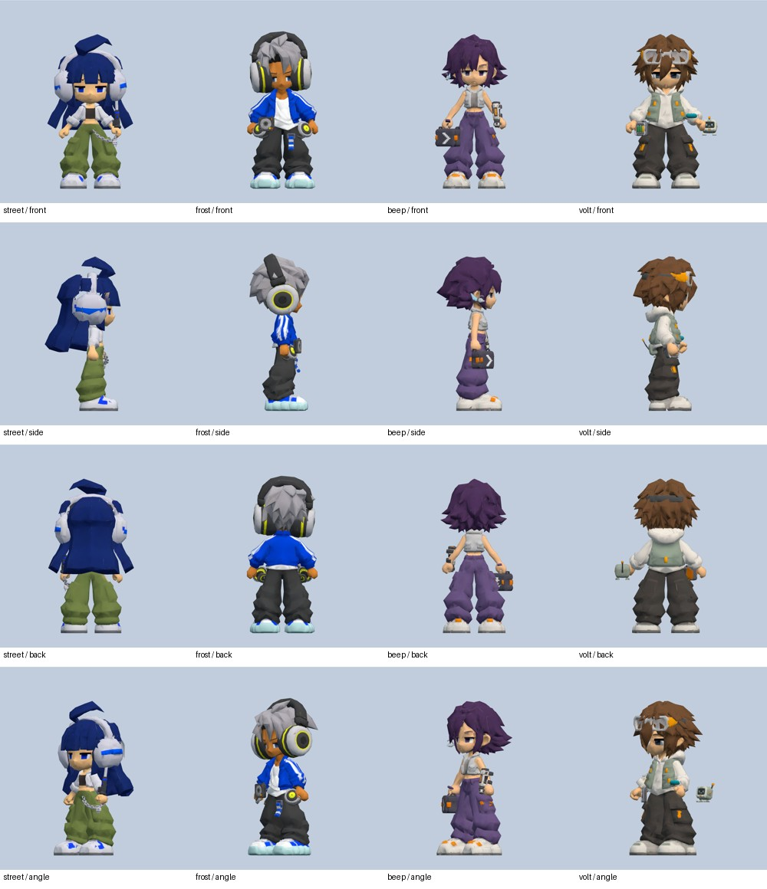
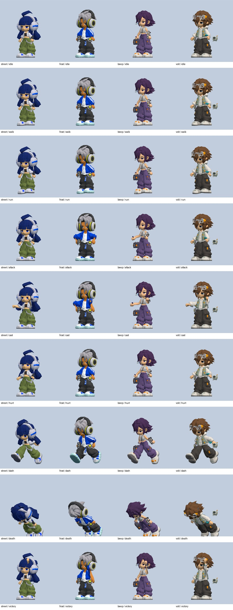

# Y2K 專裝佩戴與動作配合規劃

2026-10-23（Asia/Taipei）。分支 `codex/y2k-signature-equipment`；[PR #15](https://github.com/yauchai2/Game-Lab/pull/15)。

狀態：**已完成本輪 P0／P1 校正與組合檢查，已實作、已驗證；P2 缺少四個模型，未合併／未發佈。** 不涉及怪物製作，不新增正式裝備欄位。下列原規劃保留作規格；最新執行結果見文末。

## 規劃時的現況（最新結果見文末）

- 已完成：16 件上傳 GLB 的檔名對照、簡化、貼圖、內嵌、載入快取、收藏、掉落、角色限制及初步骨架掛點。電棍握持方向、發射器沿前臂方向、成對音盤已有第一版校正。
- 已驗證：逐件可裝到對應角色、掛點存在、座標有限且未飛離角色；實際換裝、存檔重載及手機預覽可操作。
- 尚未驗收：全部可穿戴組合在四方向、九動作下的穿模、掌心握持、髮型／底模衣飾重疊、肩帶連接及前後層次。既有邊界測試不能證明「沒有穿模」。
- 尚無模型：PING 髮夾、MILO 肩帶、PING 郵差包肩帶、NULL 頸繩；目前只有參考圖和簡模。

## 位置方案與逐件校正

下表「現況」是現有 `EQUIPMENT_SOCKETS` 掛點；「目標」為待驗收的佩戴規格。左右以角色自身方向為準。最終側邊位置以原角色參考圖為依據，表列位置作初始方案。

| 角色／物件 | 現況掛點 | 目標位置及主要校正 |
| --- | --- | --- |
| AKI 修補耳機 | head | 頭頂耳罩包住兩耳；頭帶避開髮束，藍色膠帶保持在指定左耳罩；先處理底模既有耳機重複問題 |
| AKI 電棍 | handR | 右掌握住黑色手柄，握點放在掌心；銀色棒身伸出拳外，攻擊時不滑柄或穿過頭部 |
| AKI 腰鏈 | hips | 沿原圖對應側腰至褲袋呈短 U 形；兩端靠近腰帶位置，避免整條浮在腹部或切入大腿 |
| AKI 插頭吊飾 | hips | 掛在腰鏈／腰帶指定端點，插腳朝下；與腰鏈相鄰但不相交，獨立持有時仍有合理掛點 |
| MILO DJ 耳機 | head | 頭帶沿髮頂、耳罩對齊兩耳；與底模既有耳部配件互斥 |
| MILO MD 隨身聽 | hips（校正後） | 胸前或側腹的肩帶末端；面板朝外、按鈕可辨認，跑步只做小幅擺動 |
| MILO 音盤 | hips，左右各一 | 兩側髖部成對安裝，圓面朝外；後支架貼近腰側、避開手掌與大腿，兩側分別校正朝向 |
| MILO 條紋布帶 | hips | 腰帶一側垂下，避免與音盤或褲管重疊；保留藍白條紋可讀性 |
| MILO 肩帶（待模型） | torso | 從肩部連至 MD 上方掛耳；肩帶與 MD 有兩個端點約束，不能只把長帶當作胸前硬板 |
| PING 髮夾（待模型） | head | 對應側瀏海外緣，隨頭部旋轉；不插進眼睛、耳機天線或頭髮中央 |
| PING 通訊耳機 | head | 左耳外側，天線朝上，耳鉤貼近耳後；避免與髮夾或髮束穿插 |
| PING 郵差包 | hips（校正後） | 放在角色側腰／髖後，前方箭頭朝外；現有胸前偏移只是起點，需校正至包袋應有位置 |
| PING 前臂發射器 | foreR | 套在右前臂外側，兩個環帶包住前臂；發射端朝手腕方向，抬臂攻擊時朝目標，避免穿入手掌 |
| PING 翻蓋手機 | handL | 左掌托住鍵盤下半部，螢幕朝角色可讀方向；保持現有開合角，跑動與施技時檢查手腕姿勢 |
| PING 郵差包肩帶（待模型） | torso | 跨過一側肩部，兩端接郵差包上方掛耳；需隨胸／肩姿勢變形，避免切進胸口或頸部 |
| NULL 防護眼鏡 | head | 以原圖確認額頭或眼前佩戴高度；兩鏡片、鼻樑、後束帶貼合頭型，避開瀏海與耳部 |
| NULL 控制器 | handR | 右掌握持或托住外殼下半部，LCD 朝外上方；按鍵不埋在手中，施技時抬腕呈現操作姿態 |
| NULL 電池盒 | hips | 腰帶側邊，背夾朝向衣服、透明面朝外；避免與控制器手臂或褲袋相交 |
| NULL 浮游寵機 | 角色根節點 | 側後方獨立漂浮，不跟手臂擺動；跟隨、待機及攻擊方向分開，不能穿過角色或擋住臉 |
| NULL 頸繩（待模型） | torso | 上端繞頸，下端連到控制器掛環；手持／胸前收納時使用不同路徑，避免拉成僵硬直線 |

## 先解決三項結構問題

### 1. 底模衣飾與裝備不能重複疊加

目前角色 GLB 本身含部分衣飾，例如 AKI 底模已有耳機。新增上傳耳機直接疊上去，不等於完成換裝。

先列出四個底模的固定衣飾與可替換部位。若能分離成獨立網格，就把該網格設為可隱藏部位；若已與皮膚／髮型合成單一網格，回到衍生建模流程分離，保留 UV、權重與既有角色 ID。不能隱藏整個角色網格，也不能改共享材質來影響其他角色。

規則：沒有稀有專裝時顯示普通底模配件；裝上專裝時切換對應部位。卸下、切角及讀檔都恢復正確外觀。幾何部位分離是美術修改，需重新驗證角色皮膚變形。

### 2. 收集整套與同時穿整套是不同範圍

現有遊戲只有「武器／外套／配件」三欄，同一角色四至六件專裝目前**不能全部同時裝上**。例如 AKI 腰鏈與吊飾都用配件欄，MILO MD 與布帶也互斥。已有的 NULL 控制器（武器）與寵機（配件）則可同時使用。

本輪佩戴校正先遵循現有合法三欄組合。預覽可另提供「整套參考」模式，讓美術檢查完整造型；它不能新增持有物品、套用戰鬥屬性，或讓未掉落的專裝出現在正式角色身上。

若後續確定要讓全部專裝同時穿戴，另做裝備系統設計，評估頭部、主手、副手、腰部、包袋、寵機欄位的屬性與舊存檔遷移。此處不預先增加欄位或把多件掉落合成一整套。

### 3. 握點、佩戴點與模型中心分離

目前模型統一中心、最大邊長為 1，適合載入與預覽；實際穿戴不能只靠模型中心對準骨頭。

每件建立 `骨架掛點 → 位置／方向／尺寸適配節點 → 模型`，另記錄物件自身的握點、面朝向、掛耳或束帶端點。基準姿勢校正後再測動畫，避免用錯誤縮放掩蓋握點偏移。角色骨架單位與遊戲座標維持既有換算，不用螢幕像素定位。

## 動作配合方式

- 電棍、手機、控制器、發射器為硬質模型，先使用既有手／前臂骨頭，不必每件新增一套完整骨架。發射器還要核對抬臂時的槍口方向。
- 必須修正握持時，對原角色動作加入局部手腕／前臂姿勢覆蓋；目前沒有手指骨骼，不能宣稱有真實按鍵或手指抓握動畫。
- 耳機與眼鏡跟頭；腰鏈、電池盒、音盤跟髖；包袋與 MD 的掛點按位置選胸或髖，擺動需有限幅度。
- 腰鏈、布帶可先用受限的輕微剛體擺動。肩帶／頸繩需要兩端點約束及少量骨骼或程序式帶狀幾何，收到模型後再決定；第一版不加入布料物理。
- 寵機在角色局部空間跟隨，死亡／換角時清理；低動態模式保留清楚位置，降低附加晃動。
- 動作只影響呈現，不改變普通攻擊命中時刻、專屬技能傷害、掉落或碰撞範圍。

## 執行順序與交付物

1. **P0：位置基準。** 四角色正／背／側／斜視圖，逐件標出握點、佩戴尺寸、朝向、掛耳；確認底模重複衣飾清單。交付位置表及第一輪對照圖。
2. **P0：主要武器校正。** 先做 AKI 電棍、MILO 成對音盤、PING 發射器及手機、NULL 控制器及寵機。交付待機、攻擊、施技的逐格對照。
3. **P1：合法組合校正。** 依現有三欄組合驗證耳機、包袋、腰部物件的層次及間距；若提供整套參考預覽，清楚標示不屬正式配裝。交付可重現的裝備組合 ID。
4. **P1：動作與視角驗收。** 九動作（待機、步行、跑步、攻擊、施技、受擊、閃避、倒地、勝利），每動作至少起始／主要姿勢／結束三個時間點，搭配四視角。自動驗證掛點／矩陣／範圍，人工核對可見穿模及握持；邊界盒相交本身不能判定穿模。
5. **P2：缺件與帶狀物。** 收到四個缺件模型後接入相同物品 ID，再做肩帶／頸繩的雙端點變形。交付帶與裝置連接的對照圖。
6. **整合驗證。** 卸下／換角／存讀檔／構築切換／重複換裝；檢查舊底模與簡模回退、快取共用不串色、重複載入不增加無用實體。最後才把相應項目改為已驗收。

## 規劃階段的核對證據與限制

已讀取 PR #15 分支的 `equipment-render.js`、`characters-render.js`、原整合紀錄及測試。規劃階段只整理位置與組合要求，當時沒有修改佩戴位置或重跑動畫視覺驗收。因此先前「16 件已接入」維持成立，但不能延伸為「16 件在所有動作與組合都已調好」。

## 2026-10-23 執行結果

- 已完成本輪尺寸與位置校正：AKI 耳機、電棍握點、腰鏈／吊飾；MILO 耳機、側腰 MD、雙側音盤與布帶；PING 左耳通訊器、側腰郵差包、前臂發射器與手機；NULL 額頭護目鏡、控制器握點、電池盒與側後寵機。
- 握點與佩戴位置現在由獨立適配節點處理，快取模型不因某一角色的偏移而改動。手機／控制器使用小幅手腕姿勢覆蓋，混合器還原原動畫後才套用，不新增手指骨骼。
- AKI 的底模耳機以來源 GLB 雜湊綁定的索引遮罩作條件替換，原始 GLB、UV、權重及動畫不變。只有裝上 AKI 專屬耳機才使用快取的衍生幾何，卸下即恢復原幾何；遮罩不切入中央臉部。這是對原「回建模流程分離」方案的實作調整，降低重匯出對既有骨架的影響。
- 手持 PING 手機時，左手純外觀裝扮暫不繪製以免重疊；持有與設定不變，卸下手機後恢復。
- 腰鏈、吊飾及布帶加入有限幅度擺動，寵機保留獨立跟隨；減少動態偏好降低附加晃動。傷害與掉落規則不變。
- 獨立預覽新增逐件／三欄合法搭配／整套參考、四角色、九動作、四視角、播放暫停及時間拖桿。整套額外物件只增加到預覽場景，不增加正式欄位或收藏。
- 自動檢查涵蓋 **16 種合法配裝 × 9 動作 × 3 時間點 × 4 視角 = 1,728 組**骨架矩陣、掛點與抽樣蒙皮範圍；另外驗證電棍實際握點、手腕不累積偏移、耳機替換／恢復、NULL 控制器與寵機共存、左手裝扮恢復。
- 已截取並檢視四角色九動作的代表幀與待機四視角，另有手機預覽。這不等於逐幀網格碰撞證明；佩戴接觸處允許合理交疊。
- 四個未提供 3D 的參考物件仍待補，肩帶／頸繩的雙端點變形未製作，也未擴充正式裝備欄位。

驗證入口：`node tools/test_equipment_fit.cjs`、本機 8780 伺服器啟動後執行 `node tools/test_equipment_fit_browser.cjs`。來源／建置回歸記錄於 `y2k-equipment/fit-checks.json`，瀏覽器結果於 `y2k-equipment/fit-browser.json`。
