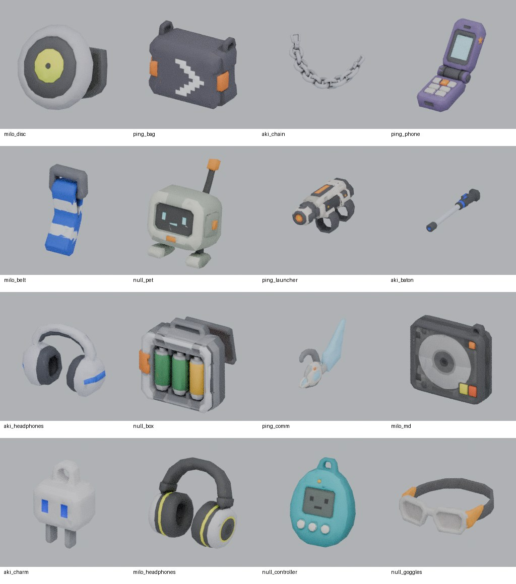
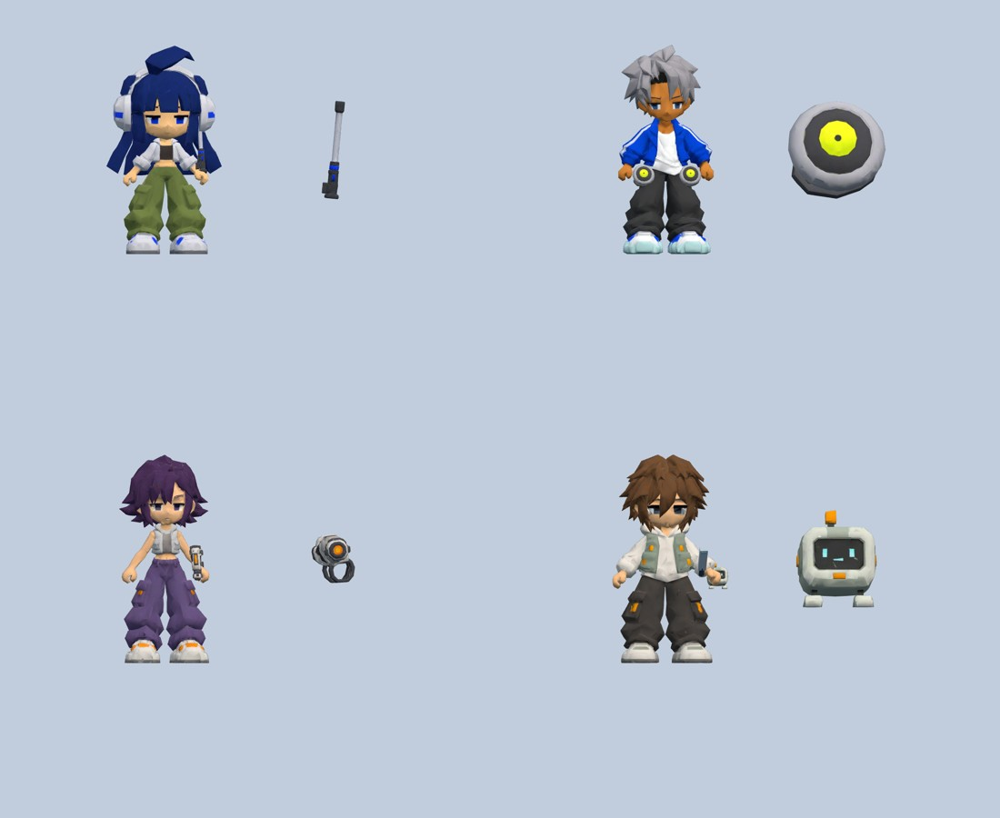

# Y2K 角色專裝整合

狀態：已實作、已驗證、已推送；未合併、未發佈。分支 `codex/y2k-signature-equipment`；[PR #15](https://github.com/yauchai2/Game-Lab/pull/15)。2026-10-23（Asia/Taipei）。

本次 Google Drive ZIP 的 16 件匿名 GLB 已按 `asset_list.zip` 圖片逐件對照，接入 AKI、MILO、PING、NULL 的裝備、地面掉落與收藏圖示。原始 ZIP 和高面數 GLB 留在工作區，不提交進 Git。這是開發候選，未更新公開 Pages 或建立 Release。

獨立開啟 `dist/equipment-review.html` 可逐件旋轉檢查原模型、角色骨架位置及普通裝備簡模，不啟動遊戲、不讀寫進度。`dist/idle-hero-review.html` 是使用獨立存檔鍵的整合試玩。

## 掉落與收藏

每次擊殺額外做一次獨立判定，成功後從 20 件專裝均勻抽一件。以下是「任一專裝」的總機率；單一指定裝備機率再除以 20。

| 敵人 | 任一專裝機率 | 平均擊殺數 |
| --- | --- | --- |
| 小怪 | 0.001% | 100,000 |
| 菁英 | 0.01% | 10,000 |
| 首領 | 0.1% | 1,000 |

平均值不是保證。普通暗金池、暗金保底、幸運詞綴和城市核心合成都不產生專裝。離線精算使用相同判定；長時間離線的估算部分按折減後小怪擊殺數獨立抽取，採小怪機率，不複製或放大已觀察到的專裝。

專裝沿用暗金收藏的實體物品、重複品、改機與存檔機制。其他角色可以拾取收藏，但不能自動穿上、手動換上或透過「上一件」穿上。切換角色時，不相容專裝回到收藏。舊存檔及九款既有核心 ID 保留。

沿用現有三欄位：主要攻擊裝置放武器、穿戴物放外套欄、隨身裝置放配件。NULL 控制器是武器、浮游寵機是配件，可同時使用。MILO 的音盤會左右成對掛上。沒有專裝時使用簡單幾何物件；NULL 的基本寵機也用簡模。

## 素材與後續替換

| 角色 | 本次 3D 模型 |
| --- | --- |
| AKI | 修補耳機、伸縮電棍、腰鏈、插頭吊飾 |
| MILO | DJ 耳機、MD 隨身聽、音盤、條紋腰帶布帶 |
| PING | 通訊耳機、郵差包、前臂發射器、翻蓋手機 |
| NULL | 防護眼鏡、電子寵物控制器、電池盒、浮游寵機 |

另外四件只有圖片參考：PING 髮夾、MILO MD 肩帶、PING 郵差包肩帶、NULL 頸繩。這四件保留專裝 ID 和角色限制，暫用簡模，詳情標示「目前只有參考圖，暫用簡模」。補模型後可沿用 ID，既有收藏會直接顯示新外觀。

- `assets/equipment/source-map.json`：人工檢視後的匿名 GLB → 穩定模型 ID 對照。
- `assets/equipment/manifest.json`：每個原始檔與衍生檔 SHA-256、原始及衍生三角面、檔案大小。
- `tools/model/prepare_equipment.py`：Blender 轉換；原始每件約 150 萬面，衍生每件約 3,000 面，保留原底色貼圖並縮至 512px。
- `tools/model/pack_equipment.py`：核對雜湊及預算後，產生 GLB、預覽圖示及單檔內嵌資料。16 件 GLB 合計約 3.1 MB。
- `src/game/equipment-render.js`：模型快取、材質及骨架掛點。未來增加模型時在這裡校正位置；一般裝備簡模在 `04-render.js`。

所有模型為使用者提供、在本機衍生，未呼叫付費生成服務。記錄的來源不代表第三方授權認證。角色原模型內建的衣飾仍屬角色底模；本次移除的預設專武是程式額外繪製的舊幾何配件。

## 驗證

`node tools/test_signature_equipment.cjs` 檢查掉落門檻、與普通暗金池隔離、角色限制、拾取與存檔身分、上一件限制、離線估算，以及 16 件 GLB 雜湊、內嵌資料一致性、面數及體積預算。

`node tools/test_signature_equipment_browser.cjs` 在 Chromium 軟體 WebGL 執行 20 件參考項目的掛點、16 件匯入模型、有限幾何範圍、手機預覽、正式遊戲換裝、角色不符按鈕及存檔重載。截圖是實際瀏覽器輸出；不是獨立硬體 GPU 或手機效能測量。

本次驗證結果：18 組來源／邏輯／建置檢查全數通過（`y2k-equipment/checks.json`）；專裝瀏覽器檢查通過（`y2k-equipment/browser.json`），既有裝備深度操作亦在 390px 與 1440px 通過。
